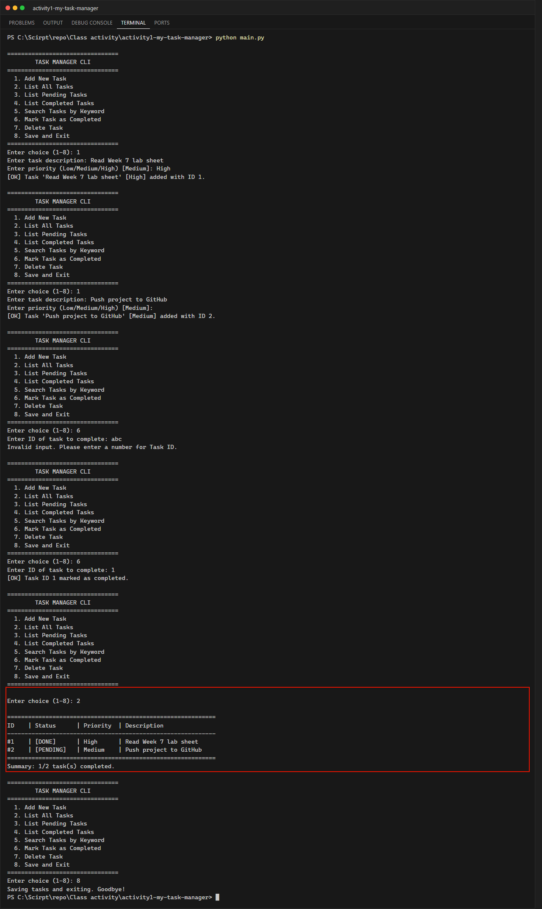

# Class Activity 1: Building a Simple CLI Application (Week 7)

**นักศึกษา:** อัษฎาวุธ เรือนแก้ว (663380303-5) · Section 2

Task Manager แบบ Command-Line ที่แยกโครงสร้างโปรเจกต์เป็นโมดูล มีการจัดการข้อผิดพลาดด้วย `try-except`
และบันทึกข้อมูลถาวรเป็น JSON

## ฟีเจอร์
- เพิ่มงาน (กำหนด priority Low/Medium/High), แสดงงานทั้งหมด / เฉพาะที่ค้าง / เฉพาะที่เสร็จ
- ค้นหางานด้วยคำค้น, ทำเครื่องหมายเสร็จ, ลบงานตาม ID
- บันทึกลง `data/tasks.json` อัตโนมัติทุกครั้งที่แก้ไข และโหลดกลับเมื่อเปิดโปรแกรม
- Error handling: ID ที่ไม่ใช่ตัวเลข (`ValueError`), ไฟล์ JSON เสีย (`JSONDecodeError`), ไฟล์ไม่มี, Ctrl+C (บันทึกก่อนออก)

## โครงสร้าง

```text
activity1-my-task-manager/
├── src/
│   ├── __init__.py
│   ├── task_data.py     # load_tasks / save_tasks (JSON)
│   └── task_logic.py    # add / list / search / complete / delete
├── data/tasks.json      # สร้างอัตโนมัติ
├── screenshots/
├── main.py              # เมนู CLI และ input handling
└── .gitignore
```

## วิธีรัน

```powershell
python main.py
```

## ผลลัพธ์ (เลือก 2. List All Tasks: 1 งาน DONE และ 1 งาน PENDING)



## Debugging ใน VS Code
ตั้ง breakpoint ที่บรรทัด `return int(raw)` ใน `read_task_id()` แล้วกด F5 → เลือกเมนู 6 → พิมพ์ `abc`
จะเห็นว่าโปรแกรมกระโดดไปที่ `except ValueError` และแสดงข้อความเตือนแทนการ crash
