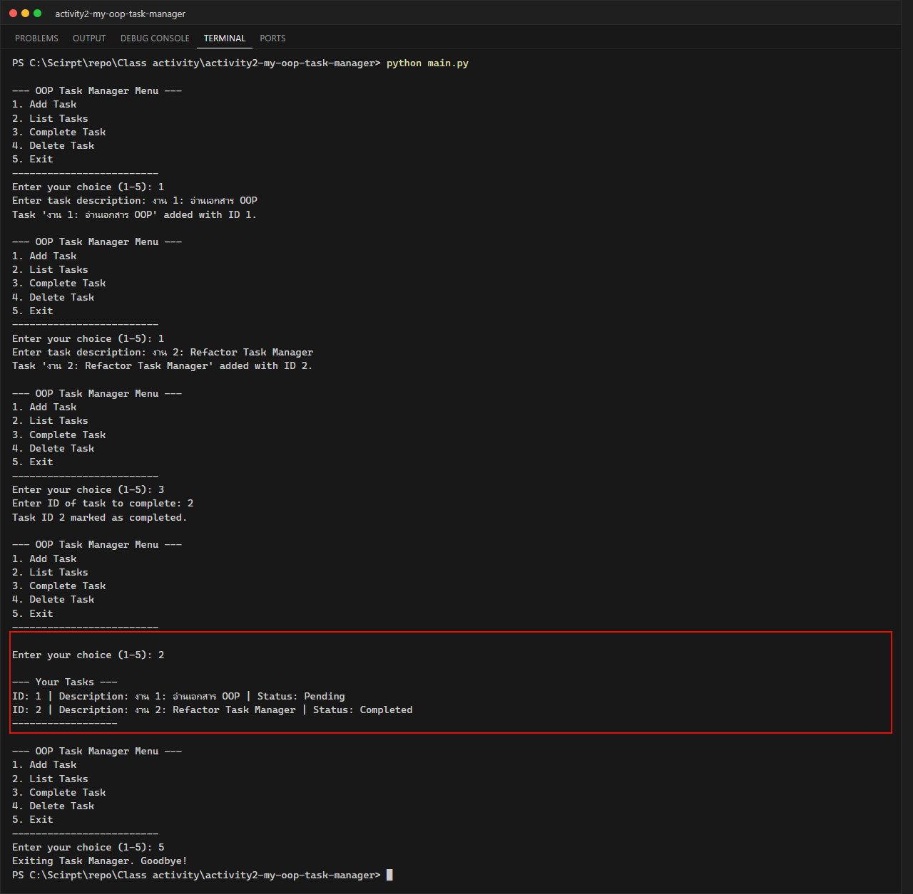

# Class Activity 2: OOP Fundamentals & Refactoring the CLI Task Manager (Week 8)

**นักศึกษา:** อัษฎาวุธ เรือนแก้ว (663380303-5) · Section 2

นำ Task Manager จาก Activity 1 (แบบ procedural: list ของ dict + ฟังก์ชัน) มา **refactor เป็น OOP**

| แนวคิด | ในโค้ด |
|---|---|
| Class / Object | `Task` คือ blueprint, `Task(1, "Read")` คือ object |
| Attributes | `id`, `description`, `completed` (Task) และ `tasks`, `next_id`, `data_file` (TaskManager) |
| Methods | `mark_complete()`, `to_dict()`, `from_dict()`; `add_task()`, `list_tasks()`, `complete_task()`, `delete_task()`, `load_tasks()`, `save_tasks()` |
| `__init__` / `self` | กำหนดค่าเริ่มต้นของแต่ละ object |
| `__str__` / `__repr__` | ข้อความสำหรับผู้ใช้ / สำหรับ debug |
| Encapsulation | `TaskManager` รวมข้อมูลงานและการอ่าน/เขียนไฟล์ไว้ด้วยกัน `main.py` เรียกแค่ method |

## โครงสร้าง

```text
activity2-my-oop-task-manager/
├── src/
│   ├── task.py           # class Task
│   └── task_manager.py   # class TaskManager
├── tests/test_task_manager.py   # unittest 6 กรณี
├── data/tasks.json
├── screenshots/
└── main.py
```

## วิธีรัน

```powershell
python main.py
python -m unittest discover tests
```

## ผลลัพธ์ (แสดงงานทั้งหมด: 1 งาน Pending และ 1 งาน Completed)


