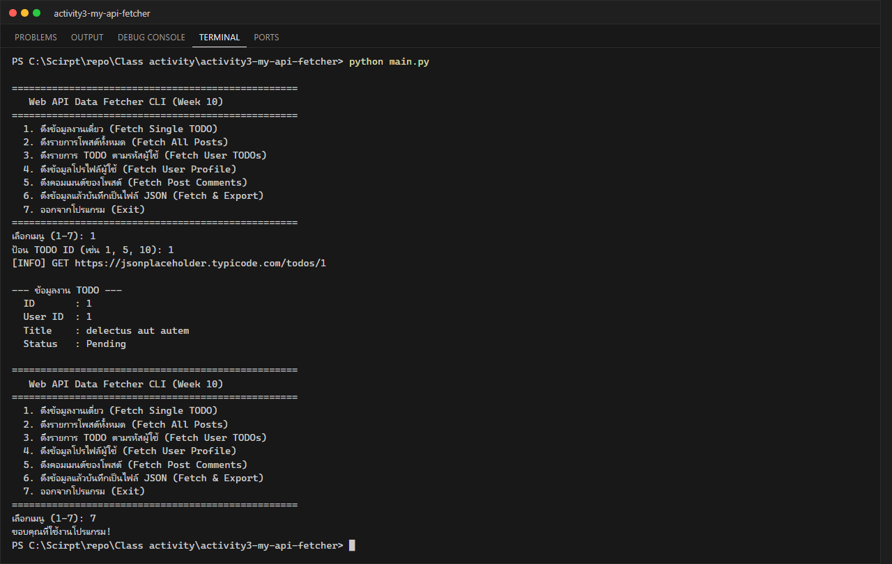
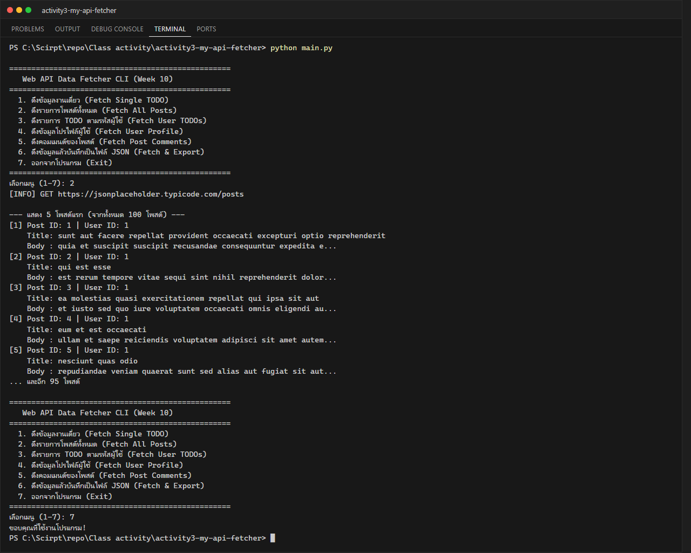
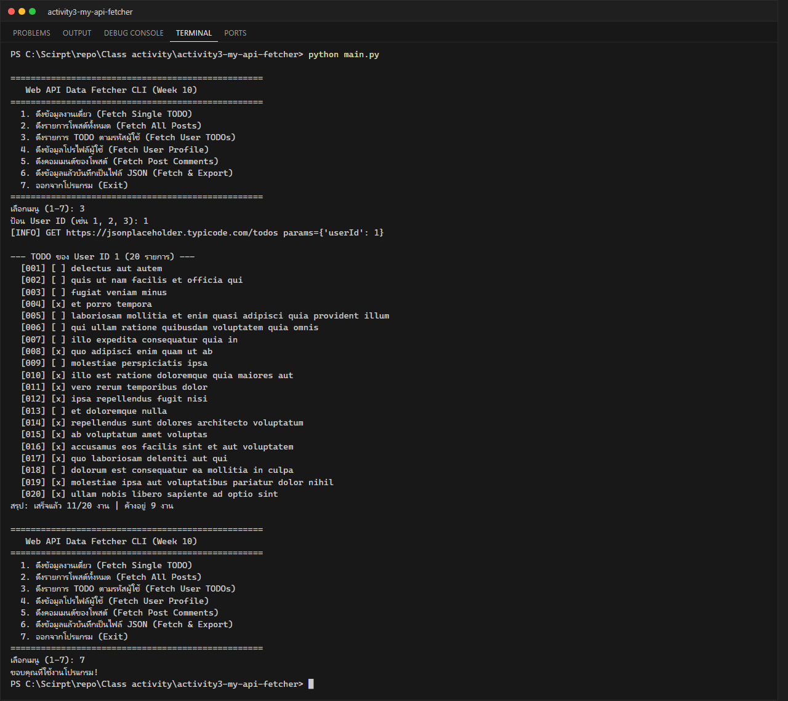
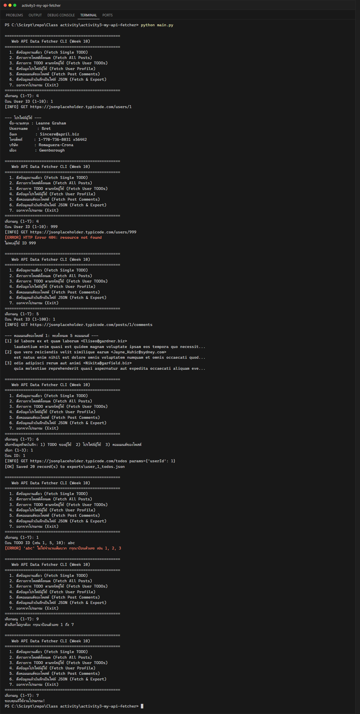

# Class Activity 3: Interacting with Web APIs – Fetching and Processing JSON Data (Week 10)

**นักศึกษา:** อัษฎาวุธ เรือนแก้ว (663380303-5) · Section 2

Interactive CLI ที่เรียก REST API [JSONPlaceholder](https://jsonplaceholder.typicode.com) ด้วย `requests`
แปลง JSON เป็น dict/list แล้วแสดงผล พร้อมจัดการข้อผิดพลาด (HTTP 4xx/5xx, Connection, Timeout, JSON decode)

## เมนู

| # | ฟังก์ชัน | Endpoint |
|---|---|---|
| 1 | Fetch Single TODO | `GET /todos/{id}` |
| 2 | Fetch All Posts (แสดง 5 รายการแรก) | `GET /posts` |
| 3 | Fetch User TODOs + สรุปจำนวนที่เสร็จ | `GET /todos?userId={id}` (query parameter) |
| 4 | Fetch User Profile (nested: `company.name`, `address.city`) | `GET /users/{id}` |
| 5 | Fetch Post Comments | `GET /posts/{id}/comments` |
| 6 | Fetch & Export → `exports/*.json` (UTF-8, `indent=4`, `ensure_ascii=False`) | — |

เมนู 4–6 ทำเพิ่มตาม `assignments/assignment_guide.md` ของ repo ตัวอย่าง (Task 1–4) และทุกเมนูตรวจสอบว่า ID
เป็นจำนวนเต็มบวก ป้อนตัวอักษรหรือ ID ที่ไม่มีอยู่จริง (เช่น 999 → HTTP 404) โปรแกรมจะไม่ crash

## โครงสร้าง

```text
activity3-my-api-fetcher/
├── src/api_client.py    # APIClient + export_to_json_file
├── exports/             # ไฟล์ JSON ที่บันทึกจากเมนู 6
├── screenshots/
├── main.py
└── requirements.txt
```

## วิธีรัน

```powershell
pip install -r requirements.txt
python main.py
```

## ผลลัพธ์

### 1. Fetch a Single TODO Item


### 2. Fetch All Posts


### 3. Fetch TODOs by User ID


### 4–6. งานเพิ่มเติม (User Profile, Comments, Export JSON, Input validation)

