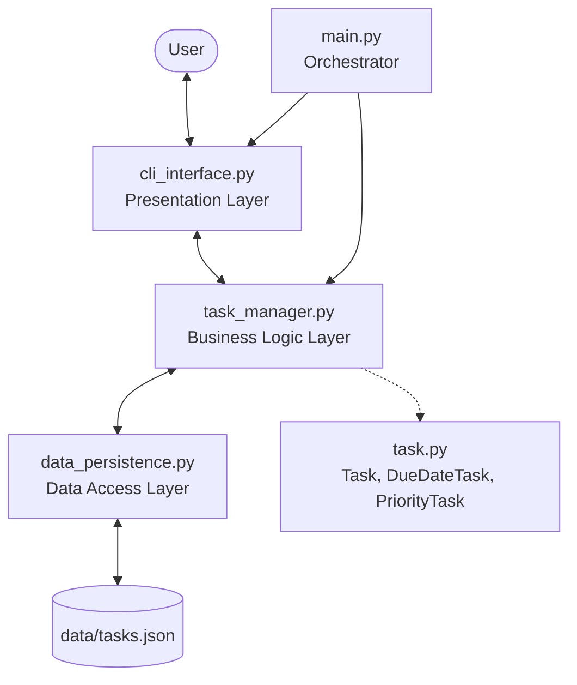
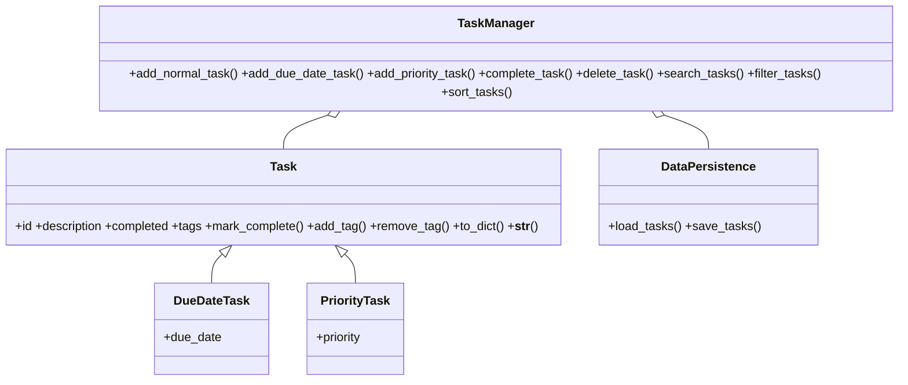

# Project Plan: Enhanced Task Manager CLI

## 1. Introduction
เอกสารวางแผนและออกแบบ Task Manager รุ่นปรับปรุง ก่อนลงมือเขียนโค้ด เพื่อหลีกเลี่ยง spaghetti code
และ feature creep โดยเน้นความเป็นโมดูล การแยกหน้าที่ (Separation of Concerns) และการต่อยอดในอนาคต

## 2. Requirements

### 2.1 Functional Requirements
- สร้างงาน 3 ประเภท: งานทั่วไป, งานมีวันครบกำหนด (`YYYY-MM-DD`), งานมีระดับความสำคัญ (High/Medium/Low)
- งานแต่ละชิ้นมีแท็กได้หลายตัว เช่น `["work", "urgent"]`
- แสดงรายการ, ทำเครื่องหมายเสร็จ, ลบ ตาม ID
- **ค้นหา** keyword ใน description และ tags (ไม่สนตัวพิมพ์เล็ก/ใหญ่)
- **กรอง** ตามสถานะ, ครบกำหนดก่อนวันที่, priority, tag (ใช้หลายเงื่อนไขร่วมกันได้)
- **เรียง** ตาม id, due date, priority (ทั้งน้อยไปมาก/มากไปน้อย)
- บันทึกอัตโนมัติทุกครั้งที่ข้อมูลเปลี่ยน และโหลดกลับเป็น object ตามชนิดเดิมเมื่อเปิดโปรแกรม

### 2.2 Non-Functional Requirements
- **Usability:** เมนูชัดเจน มีข้อความแจ้งเตือนเมื่อกรอกผิด และถามซ้ำแทนการ crash
- **Reliability:** ไฟล์ JSON เสียหรือมีชนิดงานที่ไม่รู้จักต้องไม่ทำให้โปรแกรมหยุดทำงาน
- **Maintainability:** แต่ละโมดูลมีหน้าที่เดียว
- **Extensibility:** เพิ่มชนิดงานใหม่ (เช่น `RecurringTask`) หรือเปลี่ยนที่เก็บข้อมูล (เช่น SQLite) ได้โดยแก้น้อยที่สุด

## 3. High-Level Architecture



### 3.1 Module Responsibilities

| โมดูล | หน้าที่ | ไม่ทำ |
|---|---|---|
| `task.py` | เก็บสถานะงาน, `to_dict()`, `__str__()` | ไม่อ่าน/เขียนไฟล์ |
| `data_persistence.py` | อ่าน/เขียน JSON, แปลงกลับเป็น object ตาม `_type` | ไม่มี logic การค้นหา/กรอง |
| `task_manager.py` | CRUD, สร้าง ID, search / filter / sort | ไม่มี `print`/`input` |
| `cli_interface.py` | เมนู รับ input ตรวจสอบรูปแบบ แสดงผล | ไม่แก้ข้อมูลเองโดยตรง |
| `main.py` | ประกอบทุกส่วนเข้าด้วยกันแล้วเริ่มโปรแกรม | — |

### 3.2 Data Model

```json
{ "id": 2, "description": "ส่งงานโปรเจกต์", "completed": false,
  "tags": ["assignment"], "_type": "DueDateTask", "due_date": "2026-10-20" }
```

`_type` บอกว่าต้องสร้างกลับเป็นคลาสไหน ส่วน `due_date` / `priority` มีเฉพาะคลาสลูกที่เกี่ยวข้อง

## 4. Class Diagram



## 5. Potential Challenges
1. **เรียงข้อมูลต่างชนิดกัน:** Task ทั่วไปไม่มี `due_date`/`priority` → ใช้ค่าแทน (`date.max`, `99`) ให้ไปอยู่ท้าย
2. **ลำดับ priority:** High/Medium/Low เรียงตามตัวอักษรไม่ได้ → map เป็นตัวเลข `{High:1, Medium:2, Low:3}`
3. **รูปแบบวันที่:** ตรวจด้วย `datetime.strptime(..., "%Y-%m-%d")` และถามซ้ำเมื่อผิด
4. **ข้อมูลเสีย:** ดัก `JSONDecodeError` และข้ามรายการที่ `_type` ไม่รู้จัก

## 6. Future Enhancements
- แจ้งเตือนงานใกล้ครบกำหนด / เลยกำหนด
- ย้ายข้อมูลไป SQLite (แก้เฉพาะ `data_persistence.py`)
- GUI หรือ Web UI โดยใช้ `TaskManager` เดิม
- รองรับผู้ใช้หลายคน
