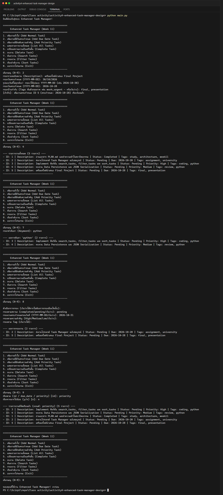

# Class Activity 4: Project Planning & Design – Building an Enhanced Task Manager (Week 11)

**นักศึกษา:** อัษฎาวุธ เรือนแก้ว (663380303-5) · Section 2

กิจกรรมฝึก **วางแผนและออกแบบซอฟต์แวร์ก่อนเขียนโค้ด**: เขียนเอกสาร [`PLAN.md`](PLAN.md)
(requirements, architecture, class diagram, ความท้าทาย, แผนต่อยอด) แล้วสร้างโค้ดตามสถาปัตยกรรมใหม่
ที่แยก `cli_interface.py` และ `data_persistence.py` ออกจาก `task_manager.py`
พร้อมทำส่วน assignment: `search_tasks`, `filter_tasks`, `sort_tasks`

## โครงสร้าง

```text
activity4-enhanced-task-manager-design/
├── src/
│   ├── task.py              # Task, DueDateTask, PriorityTask (+ tags)
│   ├── task_manager.py      # CRUD + search / filter / sort
│   ├── cli_interface.py     # เมนูและ input validation
│   └── data_persistence.py  # JSON load/save ตาม _type
├── data/tasks.json
├── screenshots/
├── main.py
├── PLAN.md                  # เอกสารออกแบบ
└── README.md
```

## วิธีรัน

```powershell
python main.py
```

## ผลการรัน (เลือกหลายตัวเลือก: เพิ่มงานพร้อมวันครบกำหนด, แสดงทั้งหมด, ค้นหา, กรอง, เรียงลำดับ)


