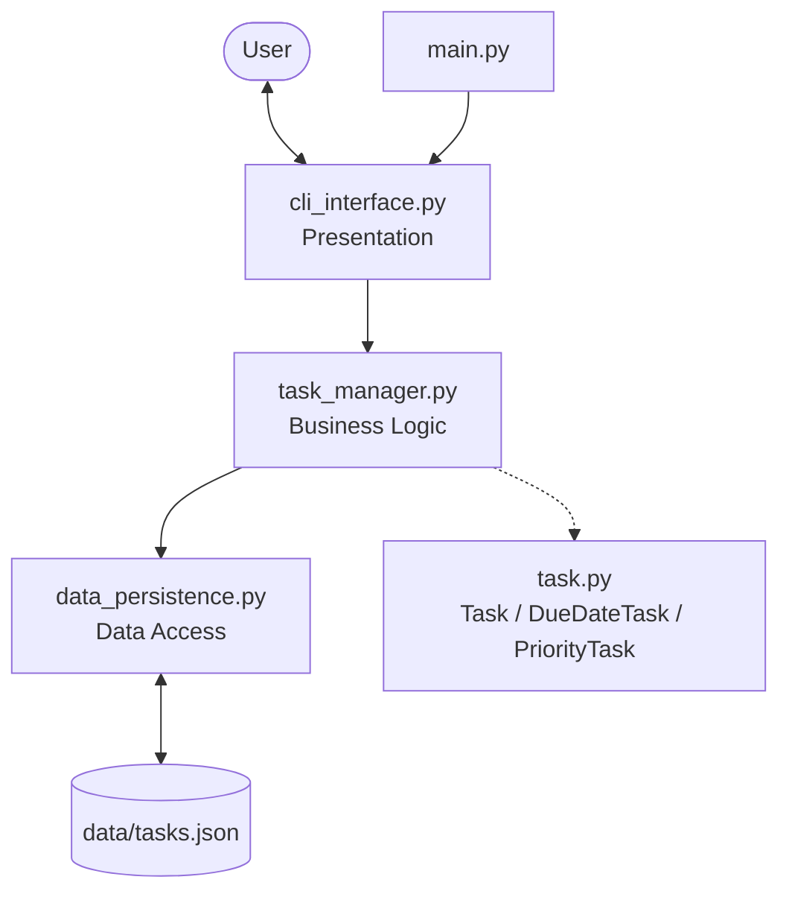
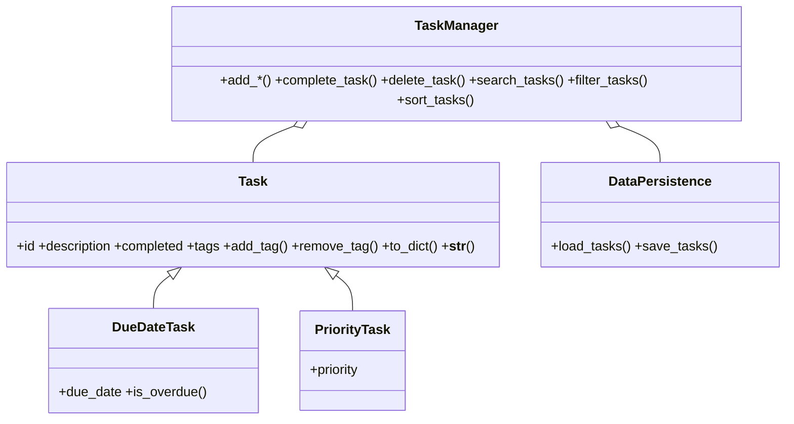

# PLAN: Enhanced Task Manager CLI

## 1. Requirements

### Functional
- เพิ่มงาน 3 ประเภท: Normal, Due Date (`YYYY-MM-DD`), Priority (`High/Medium/Low`) พร้อมแท็กหลายตัว
- แสดงรายการ, ทำเครื่องหมายเสร็จ, ลบ (ยืนยันก่อน) ตาม ID
- ค้นหา keyword ใน description และ tags (ไม่สนตัวพิมพ์)
- กรองแบบหลายเงื่อนไขพร้อมกัน: status, due before, due after, priority, tags (ต้องมีครบ)
- เรียงตาม id / description / completed / due_date / priority ทั้งสองทิศทาง
- บันทึก/โหลดอัตโนมัติจาก `data/tasks.json` และคืนสภาพเป็น object ตามชนิดเดิม

### Non-functional
- ไม่ crash เมื่อ input ผิดหรือไฟล์ข้อมูลเสีย
- แยกชั้น UI / Logic / Data / Model เพื่อให้ทดสอบและต่อยอดได้
- ใช้เฉพาะ standard library, มี unit tests ครอบคลุมทุกฟีเจอร์หลัก

## 2. Architecture

`CLIInterface` ไม่รู้จักไฟล์ JSON และ `TaskManager` ไม่เคย `print` หรือ `input` ทำให้ทดสอบ logic ได้โดยตรง

## 3. Technical Challenges & Solutions

| ปัญหา | วิธีแก้ |
|---|---|
| **Polymorphic sort**: เรียงตาม `due_date` แต่ `Task`/`PriorityTask` ไม่มี `due_date` ถ้าใช้ `date.max` เป็น key แล้ว `reverse=True` งานที่ไม่มีวันจะเด้งขึ้นบนสุด | แยกเป็น 2 กลุ่ม (มีค่า / ไม่มีค่า) เรียงเฉพาะกลุ่มที่มีค่าตามทิศทางที่ต้องการ แล้วต่อกลุ่มที่ไม่มีค่าไว้ท้ายเสมอ |
| ลำดับ priority ไม่ใช่ลำดับตัวอักษร (High < Low < Medium) | ใช้ `PRIORITY_MAP = {"High": 1, "Medium": 2, "Low": 3}` เป็น sort key |
| สร้าง object กลับจาก JSON ให้ถูกคลาส | เก็บ `_type` ใน `to_dict()` และใช้ตาราง `{"Task": Task, ...}` ตอนโหลด |
| ไฟล์เก่าไม่มี `tags`, มี `_type` ที่ไม่รู้จัก หรือวันที่ผิดรูปแบบ | `setdefault("tags", [])`, ข้ามเฉพาะรายการที่เสียพร้อมเก็บคำเตือน แทนที่จะทิ้งข้อมูลทั้งไฟล์ |
| ไฟล์อาจเสียถ้าโปรแกรมถูกปิดระหว่างบันทึก | เขียนลง `tasks.json.tmp` ก่อนแล้วใช้ `os.replace()` (atomic) |
| แท็ก `Study`, ` study ` ถูกนับเป็นคนละแท็ก | normalize ด้วย `strip().lower()` ทุกจุดที่รับแท็ก |
| ค่า path `data/tasks.json` ผิดเมื่อรันจากโฟลเดอร์อื่น | อ้างอิง path จากโฟลเดอร์โปรเจกต์ (`PROJECT_ROOT`) |

## 4. Testing

`tests/test_task_manager.py` มี 12 กรณีใน 2 กลุ่ม
- `TestTaskModels`: แท็ก, `__str__`, validation, `to_dict`, overdue
- `TestTaskManagerLogic`: CRUD + ID ไม่ซ้ำ, search, filter เดี่ยว/รวม, sort ทุกเกณฑ์ทั้งสองทิศทาง,
  round-trip persistence, ไฟล์เสียและไฟล์รูปแบบเก่า
  (ทุกเทสใช้ไฟล์ชั่วคราวใน `tempfile.mkdtemp()` จึงไม่แตะ `data/tasks.json` จริง)

## 5. Lessons Learned
- การแยกชั้นตั้งแต่ออกแบบทำให้เขียน unit test ให้ logic ได้ง่าย เพราะไม่ต้องจำลอง input/print
- Inheritance + method overriding (`_extra_info`) ลดโค้ดซ้ำใน `__str__` ของคลาสลูก
- ควรคิดถึง "ข้อมูลที่ไม่มีค่า" (None/ไม่มี attribute) ตั้งแต่ออกแบบ sort/filter
- ข้อมูลที่ผู้ใช้กรอกต้อง validate ทั้งที่ UI (ถามซ้ำ) และที่ model (raise ValueError) เป็นสองชั้น

## 6. Future Work
- งานแบบทำซ้ำ (`RecurringTask`) และการแจ้งเตือนงานใกล้ครบกำหนด
- แก้ไขรายละเอียด/แท็กของงานที่มีอยู่, undo
- ย้ายที่เก็บข้อมูลไป SQLite โดยเปลี่ยนเฉพาะ `data_persistence.py`
- ทำ GUI/เว็บ (เช่น FastAPI) โดยใช้ `TaskManager` เดิม
