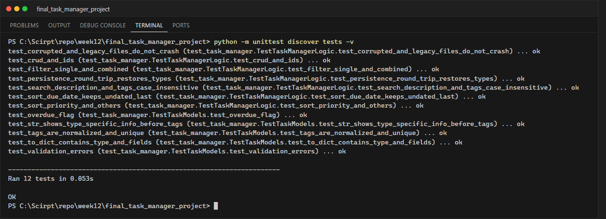
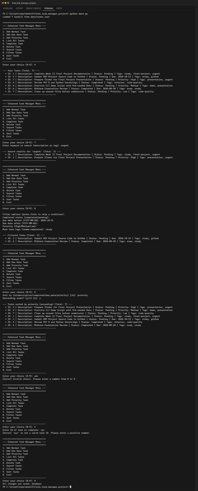

# Lab 12: Final Project – Enhanced Task Manager CLI

**นักศึกษา:** อัษฎาวุธ เรือนแก้ว · **รหัสนักศึกษา:** 663380303-5 · **Section:** 2 · **วันที่ส่ง:** 11 ต.ค. 2569

โปรแกรมจัดการงานผ่าน Command Line ที่ออกแบบแบบ OOP แยกชั้น (Separation of Concerns)
รองรับงาน 3 ประเภท, ระบบแท็ก, ค้นหา, กรองหลายเงื่อนไข, เรียงลำดับ และบันทึกข้อมูลถาวรเป็น JSON

## ฟีเจอร์

| ฟีเจอร์ | รายละเอียด |
|---|---|
| ประเภทงาน | `Task` (ทั่วไป), `DueDateTask` (มีวันกำหนดส่ง + แจ้ง OVERDUE), `PriorityTask` (High/Medium/Low) |
| Tags | หลายแท็กต่องาน, normalize เป็นตัวพิมพ์เล็กและตัดช่องว่าง, ไม่ซ้ำ (`add_tag` / `remove_tag`) |
| Search | partial match ไม่สนตัวพิมพ์ ทั้งใน description และ tags |
| Filter | สถานะ AND ส่งก่อนวันที่ AND ส่งหลังวันที่ AND priority AND ต้องมีแท็กครบทุกตัว |
| Sort | `id`, `description`, `completed`, `due_date`, `priority` ทั้ง ascending/descending โดยงานที่ไม่มีค่าของเกณฑ์นั้นอยู่ท้ายเสมอ |
| Persistence | บันทึกอัตโนมัติทุกครั้งที่เปลี่ยนแปลง, โหลดกลับเป็น object ตาม `_type`, ไฟล์เสีย/รายการผิดรูปแบบไม่ทำให้โปรแกรม crash |
| Validation | วันที่ `YYYY-MM-DD`, priority, ID ต้องเป็นตัวเลขบวก, description ห้ามว่าง, ยืนยันก่อนลบ |

## โครงสร้างโปรเจกต์

```text
final_task_manager_project/
├── src/
│   ├── task.py              # Data models: Task, DueDateTask, PriorityTask
│   ├── data_persistence.py  # อ่าน/เขียน data/tasks.json
│   ├── task_manager.py      # Business logic: CRUD, search, filter, sort
│   └── cli_interface.py     # เมนูและการรับ/ตรวจสอบ input
├── data/tasks.json          # ข้อมูลตัวอย่าง 7 รายการ (ครบทุกประเภท + tags)
├── tests/test_task_manager.py   # Unit tests 12 กรณี
├── screenshots/
├── main.py
├── PLAN.md                  # การออกแบบ ปัญหาที่พบ และสิ่งที่ได้เรียนรู้
└── PRESENTATION.md          # โครงร่างการนำเสนอ 7 ส่วน
```

| โมดูล | หน้าที่ | หลัก OOP |
|---|---|---|
| `task.py` | สถานะและการแสดงผลของงาน | Inheritance, Method overriding (`to_dict`, `_extra_info`), Encapsulation |
| `data_persistence.py` | Serialization / Deserialization | Polymorphism (`task.to_dict()`), Error handling |
| `task_manager.py` | CRUD + Search/Filter/Sort | Polymorphic sort ด้วย `isinstance` |
| `cli_interface.py` | ติดต่อผู้ใช้ | Single Responsibility, Input validation |

## วิธีรัน

```powershell
python main.py                         # ใช้ได้กับ Python 3.10+ ไม่ต้องติดตั้งไลบรารีเพิ่ม
python -m unittest discover tests -v   # รันชุดทดสอบ
```

## ผลการทดสอบ

```text
Ran 12 tests in 0.080s

OK
```



## ตัวอย่างการใช้งาน (เลือกอย่างน้อย 2 ตัวเลือก)

ลำดับที่สาธิต: `4` แสดงทั้งหมด → `7` ค้นหา `urgent` → `8` กรองงานที่ส่งก่อน 2026-10-31 และมีแท็ก `study`
→ `9` เรียงตาม priority → ทดสอบ input ผิด (`abc`, ID `xyz`) → `0` ออก


