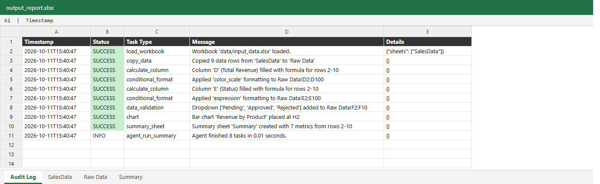
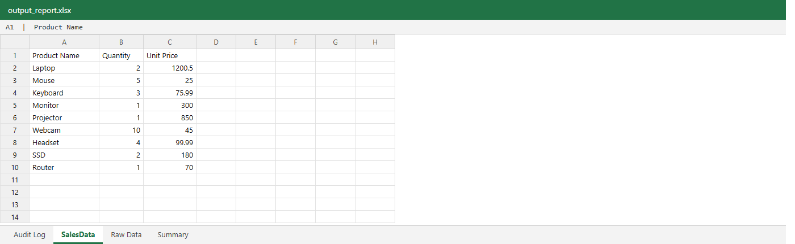
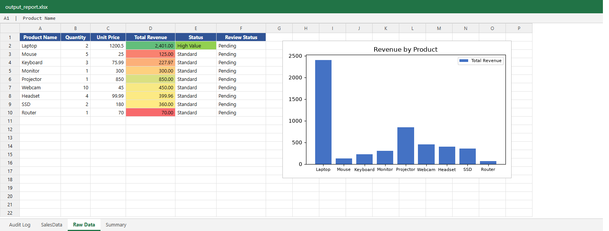
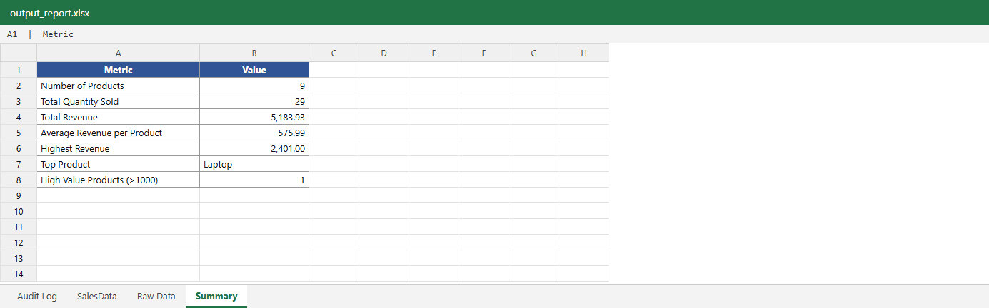
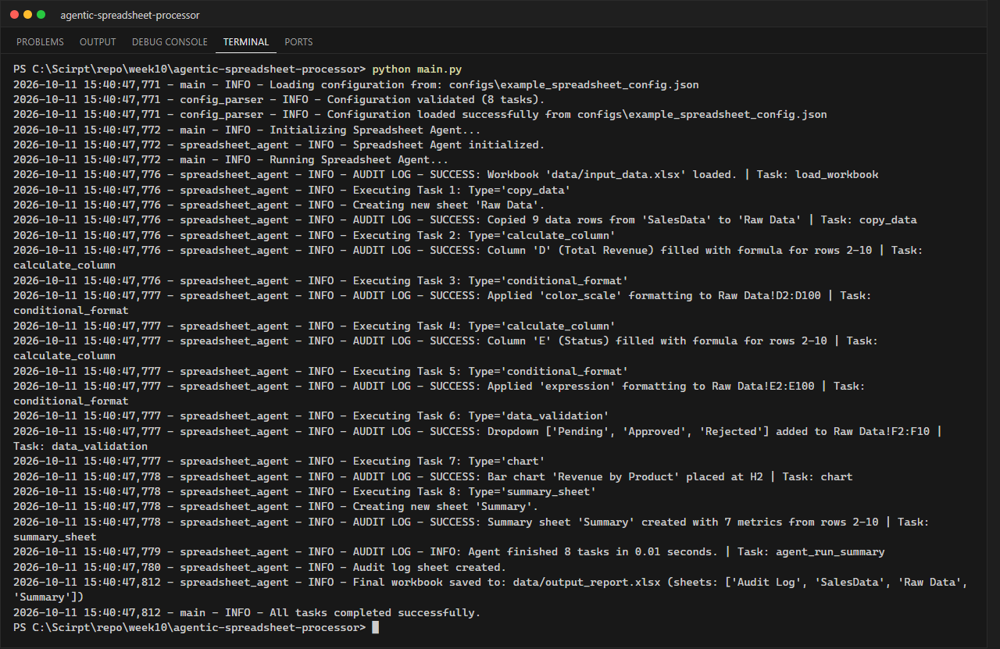

# LabX ADV Week 10: Advanced Spreadsheet Automation & Agentic Workflows

**นักศึกษา:** อัษฎาวุธ เรือนแก้ว (663380303-5) · Section 2

**Agentic Sales Reporter** — agent ที่อ่านรายการงาน (tasks) จาก `configs/example_spreadsheet_config.json`
แล้วจัดการไฟล์ Excel ด้วย **openpyxl** ทีละขั้นตอน (task dispatching) ได้แก่ คัดลอกข้อมูล ใส่สูตร
จัดรูปแบบตามเงื่อนไข สร้างกราฟ สร้างชีตสรุป เพิ่ม dropdown และบันทึกผลการทำงานทั้งหมดลงชีต **Audit Log**

## Tasks ที่ agent ทำ (ตาม config)

| # | type | รายละเอียด |
|---|------|-----------|
| 1 | `copy_data` | คัดลอกชีต `SalesData` → `Raw Data` พร้อมจัดหัวตาราง |
| 2 | `calculate_column` | คอลัมน์ D `Total Revenue` = `=B{row}*C{row}` (รูปแบบ `#,##0.00`) |
| 3 | `conditional_format` | Color Scale (แดง → เหลือง → เขียว) ที่ `D2:D100` |
| 4 | `calculate_column` | คอลัมน์ E `Status` = `=IF(D{row}>1000,"High Value","Standard")` |
| 5 | `conditional_format` | Expression `=$E2="High Value"` → พื้นเขียว |
| 6 | `data_validation` | คอลัมน์ F `Review Status` เป็น dropdown `Pending / Approved / Rejected` |
| 7 | `chart` | Bar chart "Revenue by Product" วางที่ H2 |
| 8 | `summary_sheet` | ชีต `Summary` ใช้สูตร `COUNT`, `SUM`, `AVERAGE`, `MAX`, `INDEX/MATCH`, `COUNTIF` |
| – | Audit Log | ชีตแรกของไฟล์ บันทึก timestamp / status / task / message ของทุกขั้นตอน |

agent ใช้ตาราง `handlers = {task type: method}` ในการ dispatch, ห่อแต่ละ task ด้วย `try/except`
(task ที่ผิดพลาดจะถูกบันทึกเป็น ERROR ใน Audit Log โดยไม่หยุด task อื่น) และใช้โมดูล `logging`
ระดับ INFO / WARNING / ERROR / CRITICAL

## โครงสร้างโปรเจกต์

```text
agentic-spreadsheet-processor/
├── configs/example_spreadsheet_config.json
├── data/
│   ├── input_data.xlsx      # สร้างด้วย create_dummy_data.py (ชีต SalesData)
│   └── output_report.xlsx   # ผลลัพธ์: Audit Log, SalesData, Raw Data, Summary
├── screenshots/
├── src/
│   ├── __init__.py
│   ├── config_parser.py       # โหลด + ตรวจสอบฟิลด์ที่จำเป็นของแต่ละ task type
│   ├── spreadsheet_agent.py   # SpreadsheetAgent (task handlers + audit log)
│   ├── google_sheets_utils.py # placeholder สำหรับ Google Sheets API (conceptual)
│   └── utils.py
├── create_dummy_data.py
├── main.py
└── requirements.txt
```

## วิธีรัน

```powershell
pip install -r requirements.txt
python create_dummy_data.py
python main.py
```

> สูตรใน `output_report.xlsx` ถูกคำนวณเมื่อเปิดไฟล์ด้วย Excel/LibreOffice (openpyxl เขียนเฉพาะสูตร)

## ผลลัพธ์

ค่าที่คำนวณได้: Total Revenue รวม **5,183.93**, เฉลี่ย **575.99** ต่อสินค้า, จำนวนขายรวม **29** ชิ้น,
สินค้าที่รายได้สูงสุดคือ **Laptop (2,401.00)** ซึ่งเป็นรายการเดียวที่เป็น High Value

### ชีต Audit Log


### ชีต SalesData


### ชีต Raw Data


### ชีต Summary


### Terminal


## Google Sheets API (แนวคิด)

`openpyxl` ทำงานกับไฟล์ `.xlsx` ในเครื่อง (cell-based) ส่วน `gspread` เรียก Google Sheets API ผ่านอินเทอร์เน็ต
(range-based, เหมาะกับงานที่ต้องแชร์/ทำงานร่วมกันบนคลาวด์) ยืนยันตัวตนด้วย Service Account (bot) หรือ OAuth (ผู้ใช้)
โครงสำหรับต่อยอดอยู่ใน `src/google_sheets_utils.py`
