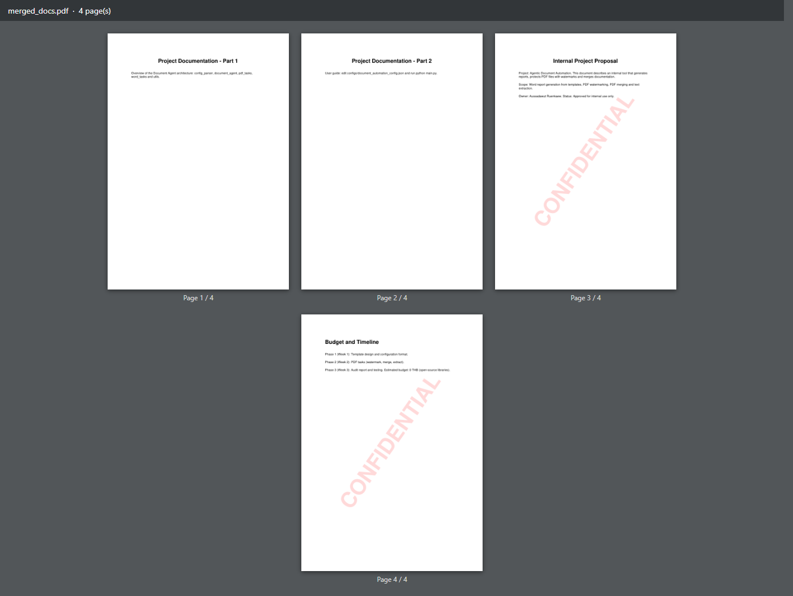
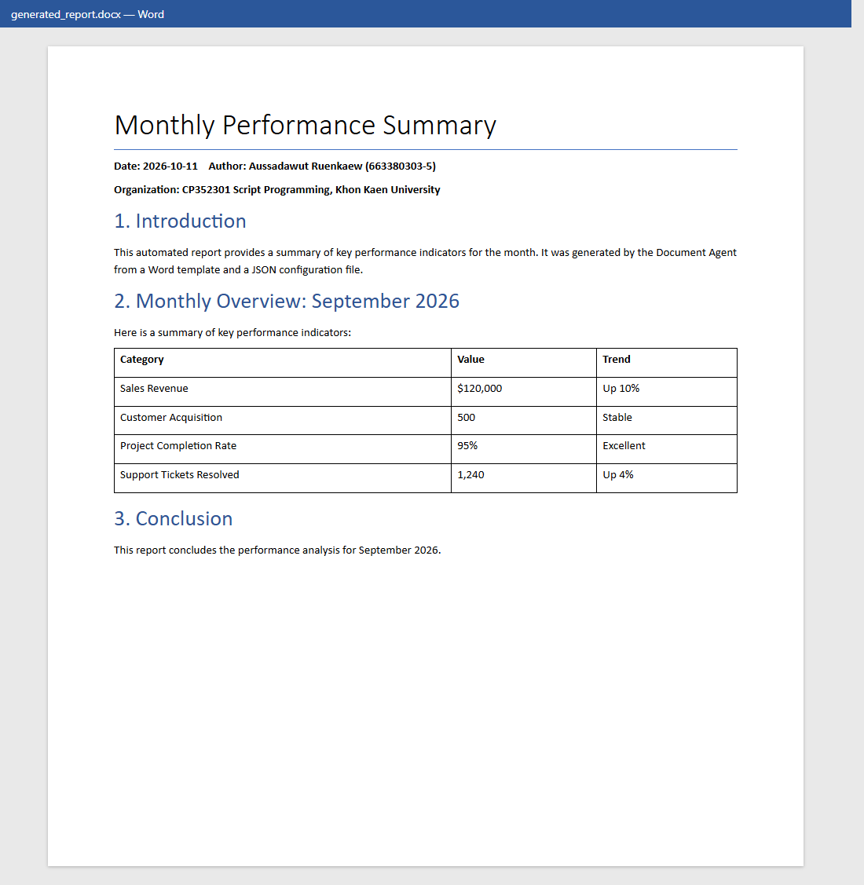
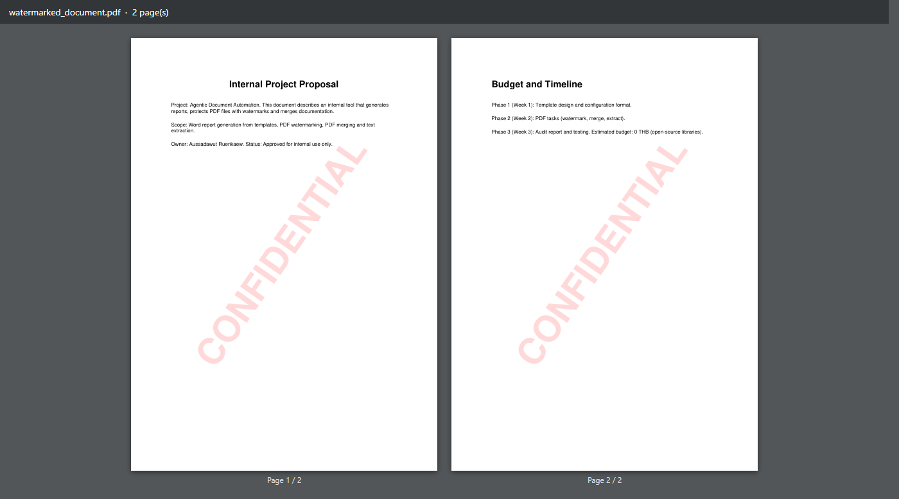
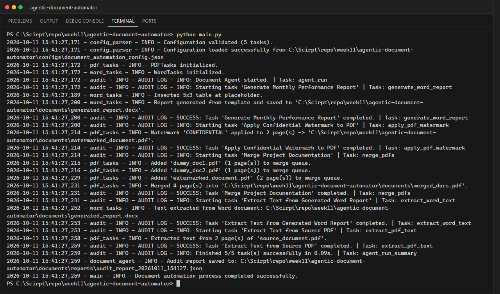

# LabX ADV Week 11: Agentic Document Automation (Advanced PDF & Word Workflows)

**นักศึกษา:** อัษฎาวุธ เรือนแก้ว (663380303-5) · Section 2

**Document Agent** ที่อ่านแผนงานจาก `configs/document_automation_config.json` แล้วทำงานเอกสารอัตโนมัติ
ด้วย **python-docx**, **PyPDF2** และ **reportlab** พร้อมบันทึก audit report ทุกครั้งที่รัน

## Tasks ใน config

| # | type | ผลลัพธ์ |
|---|------|---------|
| 1 | `generate_word_report` | เติม `{{REPORT_TITLE}}`, `{{REPORT_DATE}}`, `{{AUTHOR_NAME}}` ฯลฯ ใน `templates/report_template.docx` และแทรกตาราง KPI ที่ `{{TABLE_PLACEHOLDER}}` → `documents/generated_report.docx` |
| 2 | `apply_pdf_watermark` | สร้างหน้าลายน้ำ "CONFIDENTIAL" (สีแดงโปร่งใส 15%, เอียง 55°) ด้วย reportlab แล้ว `merge_page` ทุกหน้า → `documents/watermarked_document.pdf` |
| 3 | `merge_pdfs` | รวม `dummy_doc1.pdf` + `dummy_doc2.pdf` + `watermarked_document.pdf` → `documents/merged_docs.pdf` (4 หน้า) |
| 4 | `extract_word_text` | ดึงข้อความ + ตารางจากรายงาน Word ตามลำดับในเอกสาร → `documents/extracted_word_text.txt` |
| 5 | `extract_pdf_text` | ดึงข้อความจาก PDF ต้นฉบับ → `documents/extracted_pdf_text.txt` |

ค่าใน `global_data` (วันที่ ผู้จัดทำ หน่วยงาน) ใช้ร่วมกันทุก task และ task สามารถกำหนด `data` ของตัวเองเพิ่มได้

## โครงสร้างโปรเจกต์

```text
agentic-document-automator/
├── configs/document_automation_config.json
├── templates/report_template.docx        # template ที่มี placeholder
├── documents/
│   ├── source_document.pdf, dummy_doc1.pdf, dummy_doc2.pdf   # input
│   ├── generated_report.docx, watermarked_document.pdf, merged_docs.pdf   # output
│   ├── extracted_word_text.txt, extracted_pdf_text.txt
│   └── reports/audit_report_*.json
├── screenshots/
├── src/
│   ├── config_parser.py    # ตรวจสอบฟิลด์ที่ task แต่ละประเภทต้องมี
│   ├── document_agent.py   # DocumentAgent: dispatch task + audit log
│   ├── pdf_tasks.py        # watermark / merge / extract
│   ├── word_tasks.py       # template report / extract
│   └── utils.py
├── create_sample_documents.py
├── main.py
└── requirements.txt
```

## วิธีรัน

```powershell
pip install -r requirements.txt
python create_sample_documents.py   # (ครั้งแรก) สร้าง template และ PDF ตัวอย่าง
python main.py
```

## ผลลัพธ์

### merged_docs.pdf


### generated_report.docx


### watermarked_document.pdf


### Terminal


## ปัญหาที่พบในโค้ดตัวอย่างและวิธีแก้

| ปัญหา | วิธีแก้ |
|---|---|
| ชื่อ key ใน config เป็น `REPORT_TITLE` แต่ใน template เป็น `{{REPORT_TITLE}}` ทำให้ผลลัพธ์เหลือวงเล็บ `{{...}}` ค้างอยู่ | ตอนแทนที่จะประกอบ token เป็น `"{{" + key + "}}"` เสมอ |
| ถ้า Word แบ่ง placeholder เป็นหลาย run (`{{COMPANY_` + `NAME}}`) จะแทนที่ไม่ได้ | รวมข้อความทุก run ในย่อหน้าก่อนแทนที่ แล้วเขียนกลับลง run แรก |
| ตารางถูกต่อท้ายเอกสาร ไม่ได้อยู่ตรง `{{TABLE_PLACEHOLDER}}` | ย้าย element ตาราง (`_tbl`) ไปวางถัดจากย่อหน้า placeholder ด้วย `addnext()` แล้วลบย่อหน้าเดิม |
| `output_path` ไม่ถูกแปลงเป็น absolute path ทำให้รันจากโฟลเดอร์อื่นแล้วไฟล์ไปอยู่ผิดที่ | แปลงทุก key ที่เป็น path ใน `resolve_paths()` |
| ลายน้ำใช้ขนาด A4 ตายตัว | สร้างหน้าลายน้ำตามขนาด `mediabox` ของแต่ละหน้า |
