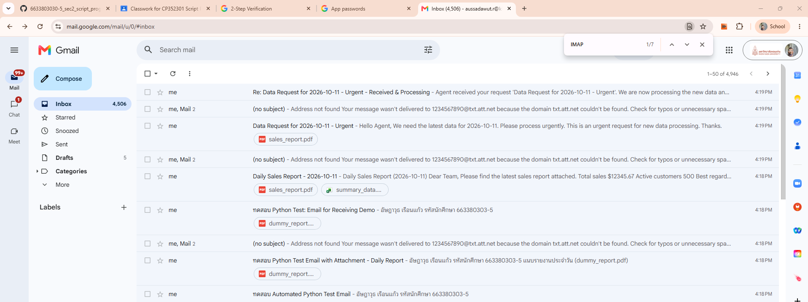
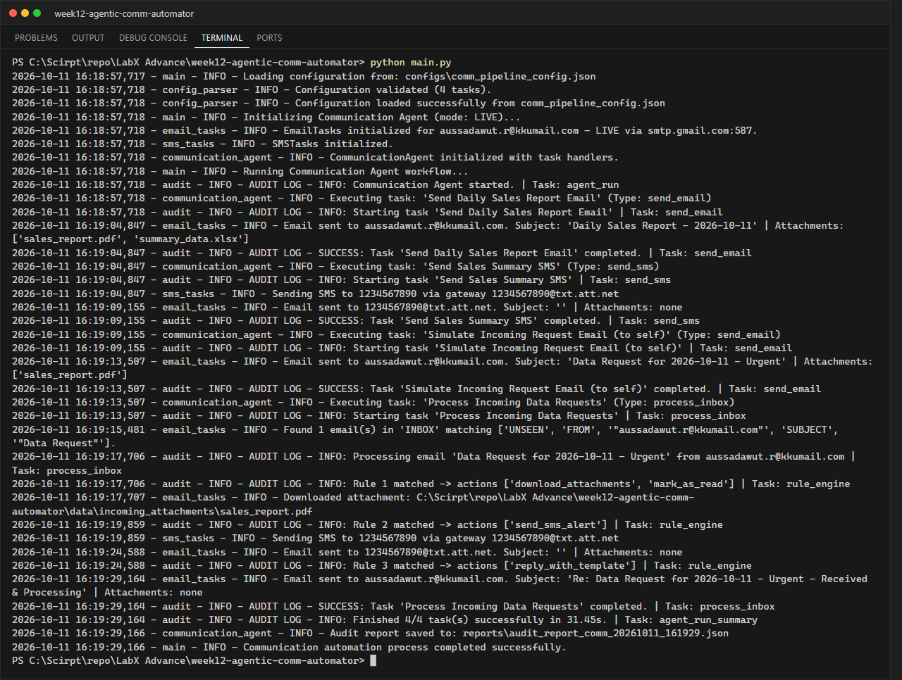
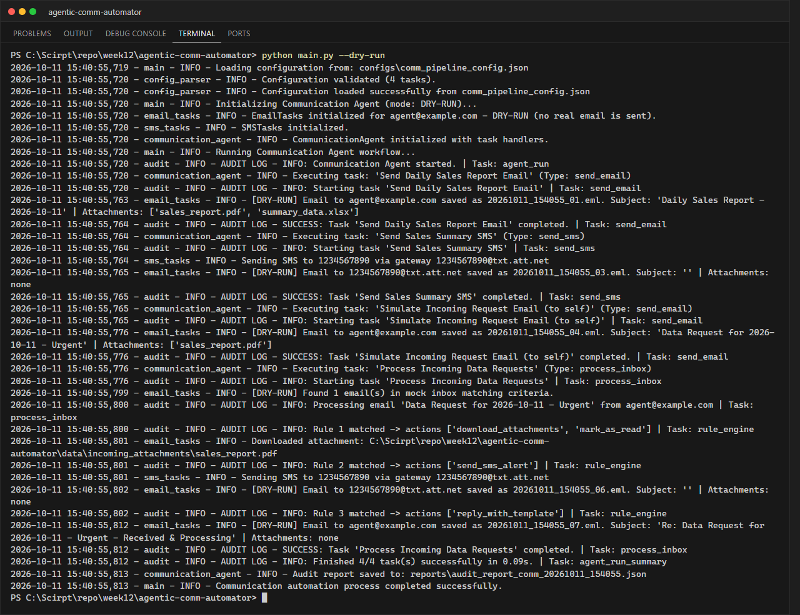
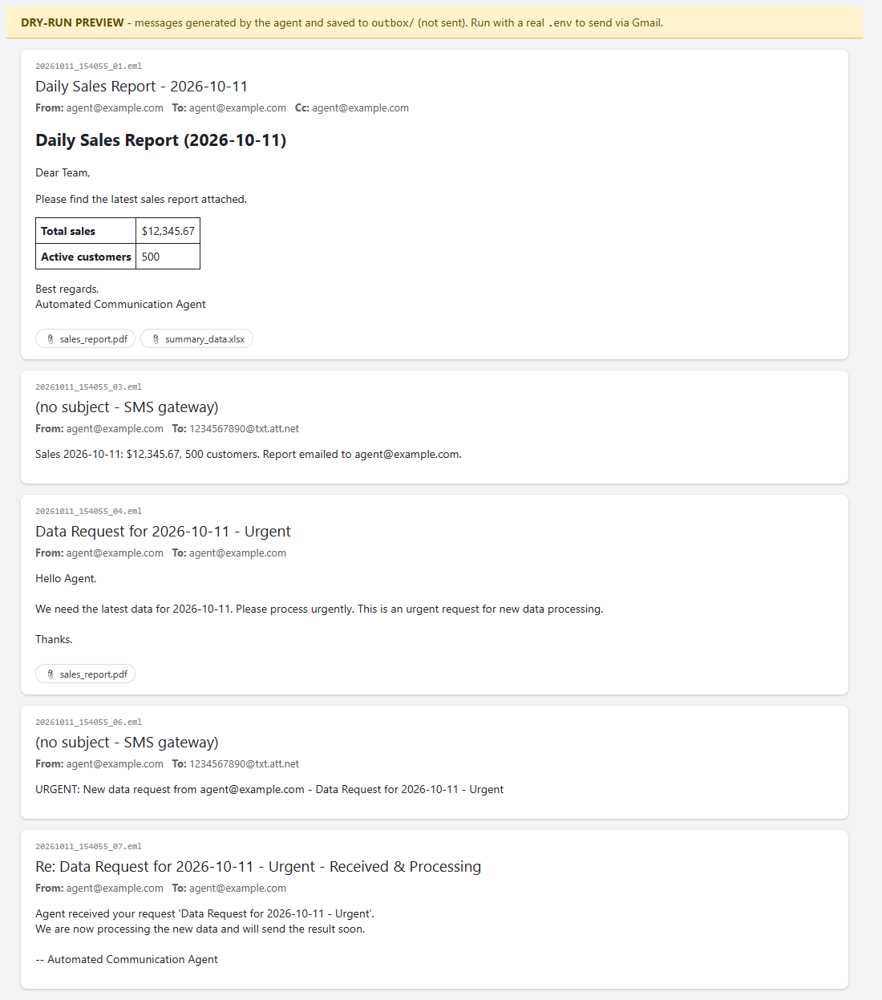

# LabX ADV Week 12: Agentic Communication Workflows (Advanced Email & SMS)

**นักศึกษา:** อัษฎาวุธ เรือนแก้ว (663380303-5) · Section 2

**CommunicationAgent** ที่ทำงานตาม `configs/comm_pipeline_config.json`: ส่งอีเมลแบบ template (HTML, To/CC/BCC,
ไฟล์แนบ), ส่ง SMS ผ่าน Email-to-SMS gateway และอ่านกล่องจดหมายเพื่อประมวลผลด้วย **กฎ if-then**
(ดาวน์โหลดไฟล์แนบ, แจ้งเตือน SMS, ตอบกลับอัตโนมัติ, mark as read) โดยบันทึกทุกการตัดสินใจลง audit report

## Workflow ใน config

| # | Task | รายละเอียด |
|---|------|-----------|
| 1 | Send Daily Sales Report Email | อีเมล HTML หัวข้อ `Daily Sales Report - {report_date}` ค่าในตารางมาจาก context (`{sales_figure:,.2f}`, `{total_customers}`) แนบ `sales_report.pdf` + `summary_data.xlsx` และ CC ถึงตัวเอง |
| 2 | Send Sales Summary SMS | ข้อความ SMS แบบ template ส่งผ่าน gateway เช่น `1234567890@txt.att.net` (ตัดเหลือ 160 ตัวอักษร) |
| 3 | Simulate Incoming Request Email | ส่งอีเมล "Data Request ... - Urgent" พร้อมไฟล์แนบถึงตัวเอง เพื่อจำลองคำขอที่เข้ามา |
| 4 | Process Incoming Data Requests | ค้นหาอีเมล UNSEEN จากตัวเองที่หัวข้อมี "Data Request" แล้วใช้กฎ: (1) มีไฟล์แนบ → ดาวน์โหลดเฉพาะ .pdf/.xlsx + mark as read (2) เนื้อหามี "urgent" → ส่ง SMS แจ้งเตือน (3) มี "new data processing" → ตอบกลับอัตโนมัติ |

แนวคิดสำคัญ
- **Context**: `self.context` เก็บข้อมูลกลาง (วันที่รายงาน ยอดขาย อีเมลผู้รับจาก `.env`) ใช้เติม template และ task
  ที่มี `output_context_key` จะเก็บผลลัพธ์ไว้ให้ task ถัดไปใช้
- **Task dispatcher**: `handlers = {"send_email": ..., "send_sms": ..., "process_inbox": ...}`
- **Secure credentials**: อ่านจาก `.env` ด้วย `python-dotenv` (ไฟล์ `.env` อยู่ใน `.gitignore`)
- **Error alert**: ถ้ามี task ล้มเหลว agent ส่งอีเมลแจ้งเตือนไปที่ `on_error_notify`
- **กันวนลูป**: อีเมลที่ขึ้นต้นด้วย `Re:` (คำตอบอัตโนมัติ) จะไม่ถูกประมวลผลซ้ำ

## โครงสร้างโปรเจกต์

```text
agentic-comm-automator/
├── configs/comm_pipeline_config.json
├── data/reports/                 # sales_report.pdf, summary_data.xlsx (ไฟล์แนบ)
├── reports/                      # audit_report_comm_*.json
├── screenshots/
├── src/
│   ├── communication_agent.py    # agent: context, dispatcher, rule engine, audit
│   ├── email_tasks.py            # SMTP ส่ง / IMAP ค้นหา-อ่าน-ดาวน์โหลด-mark read (+ dry-run)
│   ├── sms_tasks.py              # SMS ผ่าน Email-to-SMS gateway
│   ├── template_renderer.py      # เติม {placeholder} จาก context
│   ├── config_parser.py
│   └── utils.py                  # .env, logging, audit
├── create_sample_attachments.py
├── .env.example                  # ตัวอย่างไฟล์ .env (ไม่มีรหัสผ่านจริง)
└── main.py
```

## วิธีรัน

```powershell
pip install -r requirements.txt
python create_sample_attachments.py

# 1) ทดสอบโดยไม่ส่งอีเมลจริง: อีเมลถูกบันทึกเป็นไฟล์ .eml ใน outbox/ และ mock_inbox/
python main.py --dry-run

# 2) ส่งจริงผ่าน Gmail
copy .env.example .env      # แล้วแก้ SENDER_EMAIL, SENDER_APP_PASSWORD, TEST_RECIPIENT_EMAIL
python main.py
```

**การสร้าง Gmail App Password:** Google Account → Security → เปิด 2-Step Verification →
App passwords → สร้างรหัส 16 ตัวอักษร แล้วใส่ใน `SENDER_APP_PASSWORD` (ห้ามใช้รหัสผ่าน Gmail ปกติ
และห้าม commit ไฟล์ `.env`)

> SMS: Email-to-SMS gateway รองรับเฉพาะผู้ให้บริการบางรายในสหรัฐฯ (AT&T, Verizon ฯลฯ) ผู้ให้บริการในไทย
> ไม่รองรับ อีเมลที่ส่งไป gateway จึงอาจตีกลับ ในงานจริงควรใช้บริการ SMS API เช่น Twilio

## ผลลัพธ์

### ภาพหน้าจออีเมลจริง (Gmail)


> อีเมล `(no subject) - Address not found` คือ SMS ที่ส่งไป gateway `@txt.att.net` แล้วตีกลับ เพราะ gateway ใช้ได้เฉพาะเครือข่ายในสหรัฐฯ (โปรแกรมส่งออกไปถูกต้องแล้ว)

### Terminal (ส่งจริงผ่าน Gmail SMTP/IMAP)


### Terminal (dry-run)


### ตัวอย่างอีเมลที่ agent สร้าง (dry-run preview ไม่ใช่ภาพจาก Gmail)

