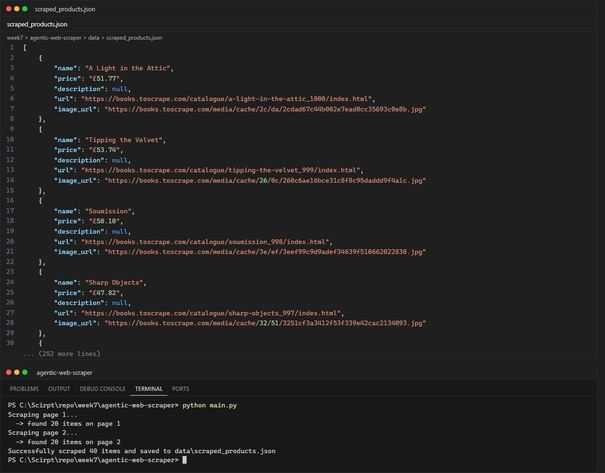

# LabX ADV Week 7: Advanced Web Scraping & Introduction to Automated Agents

**นักศึกษา:** อัษฎาวุธ เรือนแก้ว (663380303-5) · Section 2

Agentic Web Scraper ที่ใช้ **Selenium** ควบคุมเบราว์เซอร์จริง (headless Chrome) และทำงานตาม
**ไฟล์ configuration** (เสมือนเป็น autonomous agent ที่รับคำสั่ง) เพื่อดึงข้อมูลหนังสือจาก
[books.toscrape.com](https://books.toscrape.com) หลายหน้า แล้วบันทึกเป็น JSON

## โครงสร้างโปรเจกต์

```text
agentic-web-scraper/
├── configs/
│   └── example_site_config.json   # "คำสั่ง" ของ agent: URL, selectors, จำนวนหน้า, delay, retry
├── data/
│   └── scraped_products.json      # ผลลัพธ์ (40 รายการ จาก 2 หน้า)
├── docs/
│   └── ETHICS.md                  # แนวปฏิบัติด้านจริยธรรม/กฎหมาย
├── screenshots/
├── src/
│   ├── __init__.py
│   ├── config_parser.py           # โหลดและตรวจสอบ config
│   ├── data_models.py             # dataclass Product
│   ├── driver_manager.py          # สร้าง WebDriver (headless, User-Agent)
│   ├── scraper_agent.py           # ตรรกะ agent: โหลดหน้า, parse, pagination, retry
│   └── utils.py                   # save JSON, explicit wait, safe_click
├── main.py
├── test_setup.py                  # ทดสอบว่า Selenium/ChromeDriver พร้อมใช้งาน
└── requirements.txt
```

## วิธีติดตั้งและรัน

```powershell
python -m venv venv
venv\Scripts\Activate.ps1
pip install -r requirements.txt
python test_setup.py     # ควรแสดง Title: All products | Books to Scrape - Sandbox
python main.py
```

## เทคนิคที่ใช้

| หัวข้อ | การนำไปใช้ในโค้ด |
|---|---|
| Dynamic content / Browser automation | `selenium.webdriver.Chrome` + `--headless=new` |
| Waiting strategies | Implicit wait (`implicitly_wait(10)`) และ Explicit wait (`WebDriverWait` + `presence_of_element_located`) |
| Retry mechanism | `ScraperAgent._load_with_retry()` ลองใหม่สูงสุด `max_retries` ครั้ง พร้อม backoff |
| Anti-blocking พื้นฐาน | ตั้ง User-Agent, หน่วงเวลา `delay_between_pages`, จำกัด `max_pages` |
| Config-driven ("agentic") | เปลี่ยนเว็บ/selector/จำนวนหน้าได้โดยแก้เฉพาะ JSON ไม่ต้องแก้โค้ด |
| Data structuring | `dataclass Product` → `asdict()` → JSON (`ensure_ascii=False`) |

> หมายเหตุ: ชื่อหนังสือในหน้า list ถูกตัดเป็น `"A Light in the ..."` จึงอ่านจาก attribute `title`
> ของลิงก์ก่อน ทำให้ได้ชื่อเต็ม เช่น `"A Light in the Attic"`

## ผลลัพธ์การรัน


