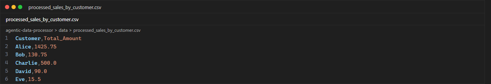
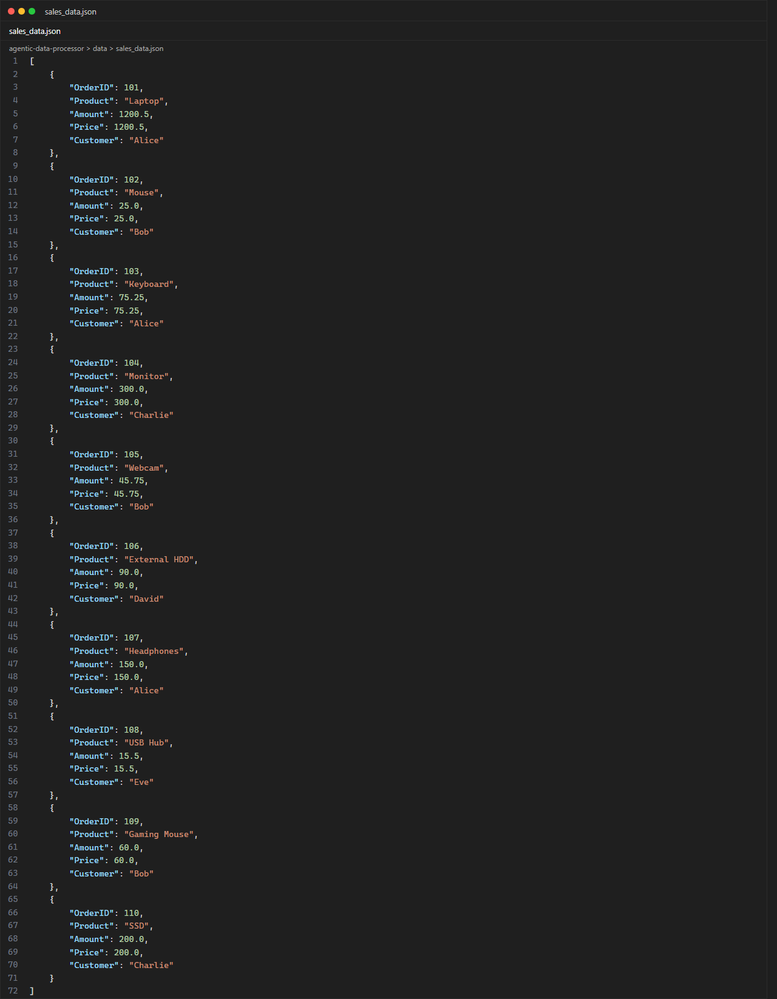
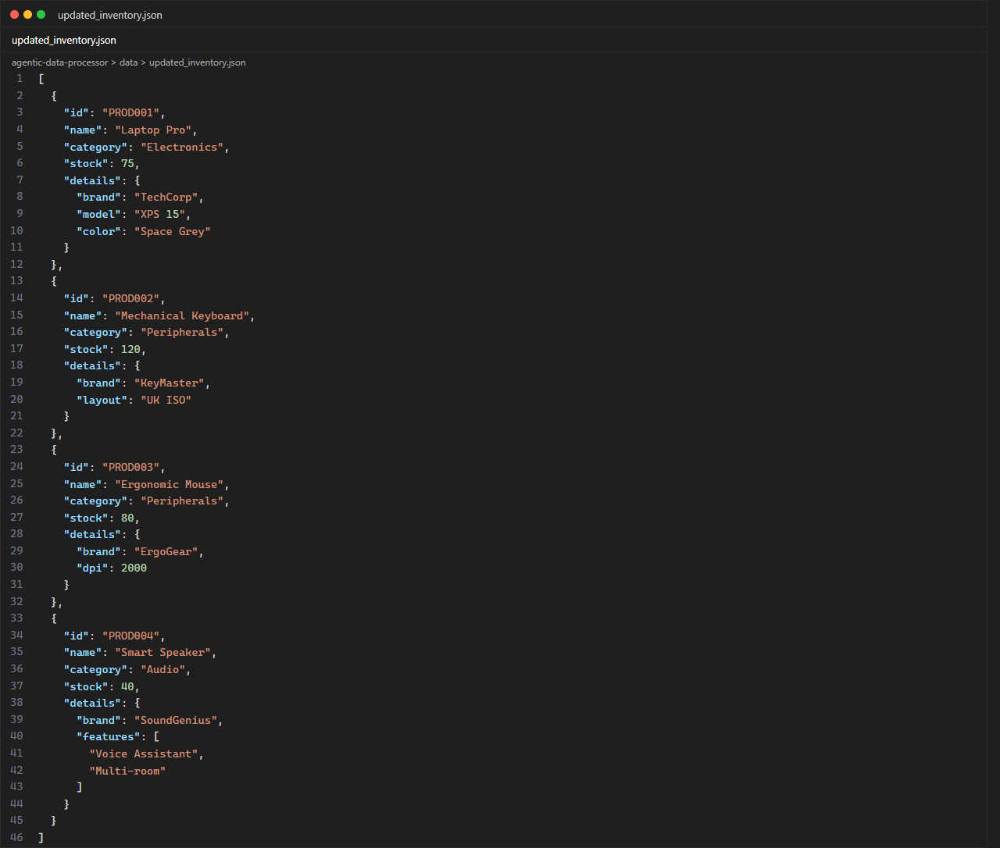
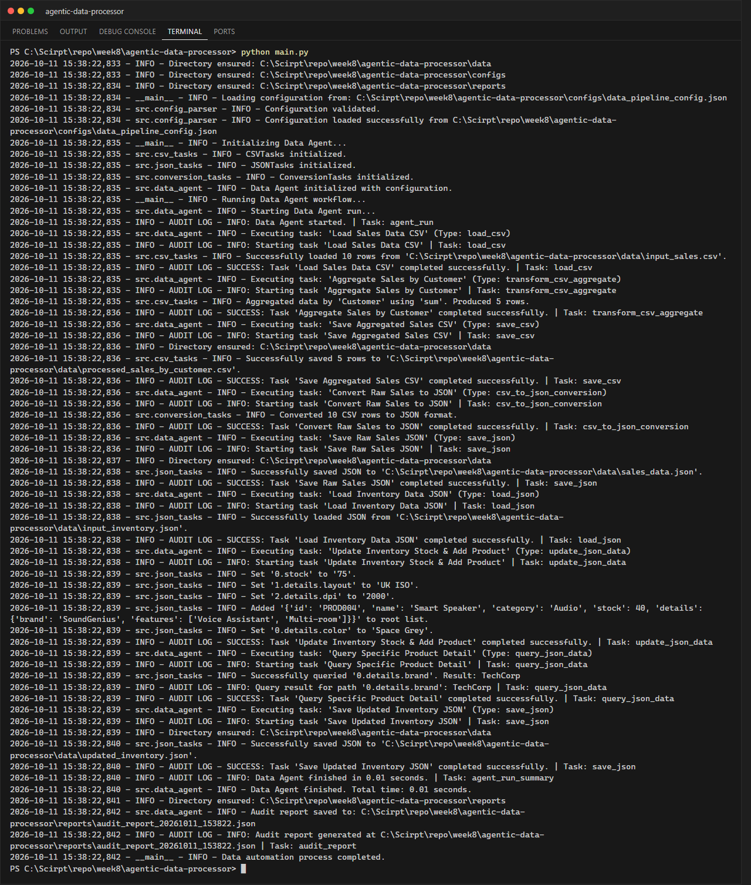

# LabX ADV Week 8: Agentic Data Processing (Advanced CSV & JSON Workflows)

**นักศึกษา:** อัษฎาวุธ เรือนแก้ว (663380303-5) · Section 2

**Data Agent** ที่อ่าน "แผนงาน" จากไฟล์ `configs/data_pipeline_config.json` แล้วดำเนินการทีละ task
โดยเก็บผลลัพธ์ระหว่างทางไว้ใน `data_store` (key → data) ทำให้ task ถัดไปนำข้อมูลไปใช้ต่อได้
และบันทึกทุกขั้นตอนเป็น **Audit Report** (JSON) ในโฟลเดอร์ `reports/`

## Pipeline ใน config

| # | Task | Type | ผลลัพธ์ |
|---|------|------|---------|
| 1 | Load Sales Data CSV | `load_csv` | `raw_sales_data` |
| 2 | Aggregate Sales by Customer | `transform_csv_aggregate` (sum `Amount` group by `Customer`) | `customer_sales_summary` |
| 3 | Save Aggregated Sales CSV | `save_csv` | `data/processed_sales_by_customer.csv` |
| 4 | Convert Raw Sales to JSON | `csv_to_json_conversion` (แปลงสตริงตัวเลขเป็น int/float) | `raw_sales_json` |
| 5 | Save Raw Sales JSON | `save_json` | `data/sales_data.json` |
| 6 | Load Inventory Data JSON | `load_json` | `raw_inventory_data` |
| 7 | Update Inventory Stock & Add Product | `update_json_data` (set ด้วย dot-path เช่น `0.stock`, `add_to_list`) | `updated_inventory_data` |
| 8 | Query Specific Product Detail | `query_json_data` (`0.details.brand` → `TechCorp`) | `queried_product_brand` |
| 9 | Save Updated Inventory JSON | `save_json` | `data/updated_inventory.json` |

## โครงสร้างโปรเจกต์

```text
agentic-data-processor/
├── configs/data_pipeline_config.json
├── data/            # input_sales.csv, input_inventory.json + ไฟล์ผลลัพธ์ 3 ไฟล์
├── reports/         # audit_report_YYYYMMDD_HHMMSS.json
├── screenshots/
├── src/
│   ├── config_parser.py     # โหลด + validate config
│   ├── csv_tasks.py         # load/save/aggregate/filter CSV
│   ├── json_tasks.py        # load/save/update (dot-path)/query JSON
│   ├── conversion_tasks.py  # CSV <-> JSON
│   ├── data_agent.py        # DataAgent: dispatch task + data_store + audit log
│   └── utils.py             # logging, audit entry
└── main.py
```

## วิธีรัน

```powershell
python main.py
```

## ผลลัพธ์

ตรวจสอบยอดรวมต่อลูกค้า: Alice = 1200.50 + 75.25 + 150.00 = **1425.75**,
Bob = 25.00 + 45.75 + 60.00 = **130.75**, Charlie = 300.00 + 200.00 = **500.00**, David = **90.00**, Eve = **15.50**

### processed_sales_by_customer.csv


### sales_data.json


### updated_inventory.json


### Terminal


## สิ่งที่แก้ไขจากโค้ดต้นฉบับ
- ลบ `from turtle import update` และ `from os import path` ที่ไม่ได้ใช้ (import `turtle` ต้องใช้ Tkinter โดยไม่จำเป็น)
- ตั้ง `logger.propagate = False` ใน `setup_logging` เพื่อไม่ให้ log แสดงซ้ำ 2 บรรทัด
- ใช้ `os.path.normpath` กับ path ใน config เพื่อให้ path แสดงผลถูกต้องบน Windows
