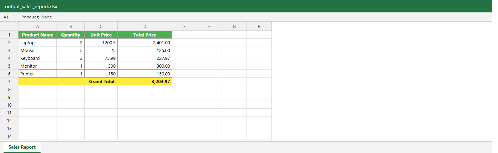
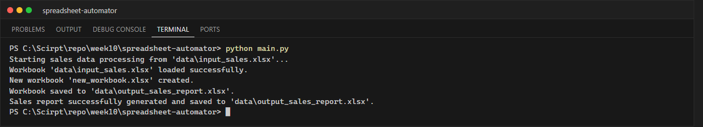

# LabX BASIC Week 10: Automating Spreadsheets (Excel & Google Sheets)

**นักศึกษา:** อัษฎาวุธ เรือนแก้ว (663380303-5) · Section 2

โปรแกรมอ่านข้อมูลยอดขายจาก Excel (`data/input_sales.xlsx`) คำนวณ `Total Price = Quantity × Unit Price`
และสร้างรายงานใหม่ที่จัดรูปแบบแล้ว (`data/output_sales_report.xlsx`) ด้วยไลบรารี **openpyxl**

## ฟีเจอร์ที่ใช้ใน openpyxl

- `load_workbook` / `Workbook` / `save` — อ่าน สร้าง และบันทึกไฟล์ `.xlsx`
- `iter_rows(min_row=2, values_only=True)` — วนอ่านข้อมูลทีละแถว (ข้ามแถวว่างอัตโนมัติ)
- `Font`, `PatternFill`, `Border`, `Alignment` — หัวตารางสีเขียว ตัวหนา ขอบตาราง แถว Grand Total สีเหลือง
- `number_format = '#,##0.00'` — รูปแบบตัวเลขเงิน
- `merge_cells` — รวมเซลล์ A:C ของแถว Grand Total
- ปรับความกว้างคอลัมน์อัตโนมัติตามความยาวข้อความ
- `try/except (ValueError, TypeError)` — ข้ามแถวที่ตัวเลขผิดรูปแบบพร้อมแสดงคำเตือน

## โครงสร้างโปรเจกต์

```text
spreadsheet-automator/
├── data/
│   ├── input_sales.xlsx           # ข้อมูลตัวอย่าง (สร้างด้วย create_input_data.py)
│   └── output_sales_report.xlsx   # รายงานผลลัพธ์
├── screenshots/
├── src/
│   ├── __init__.py
│   └── excel_processor.py         # คลาส ExcelProcessor
├── create_input_data.py           # สร้าง input_sales.xlsx ตามตัวอย่างในเอกสาร Lab
├── main.py
└── requirements.txt
```

## วิธีรัน

```powershell
pip install -r requirements.txt
python create_input_data.py   # (ครั้งแรก) สร้างไฟล์ input
python main.py
```

## ผลลัพธ์

Grand Total = 2,401.00 + 125.00 + 227.97 + 300.00 + 150.00 = **3,203.97**





## Google Sheets (ภาพรวมแนวคิด)

การทำงานกับ Google Sheets ใช้ Google Sheets API ผ่านไลบรารี `gspread` ร่วมกับ Service Account
(ไฟล์ credentials JSON) แล้วแชร์ชีตให้อีเมลของ Service Account จากนั้นใช้คำสั่งเช่น
`gc = gspread.service_account("credentials.json")`, `sh = gc.open("Sales")`,
`ws.get_all_records()` และ `ws.update(...)` — ห้าม commit ไฟล์ credentials ขึ้น GitHub
