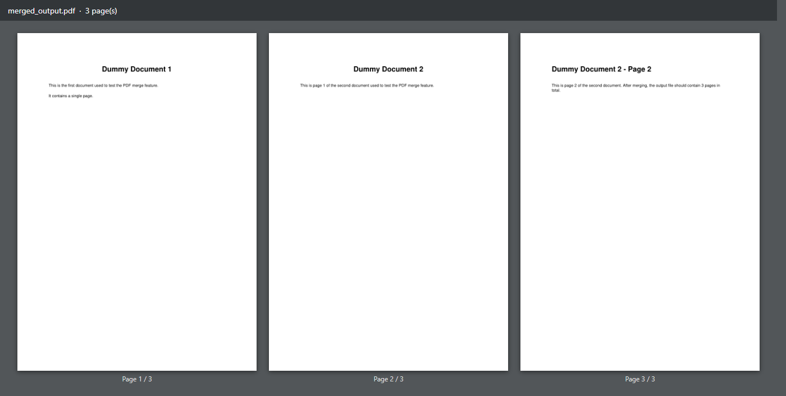
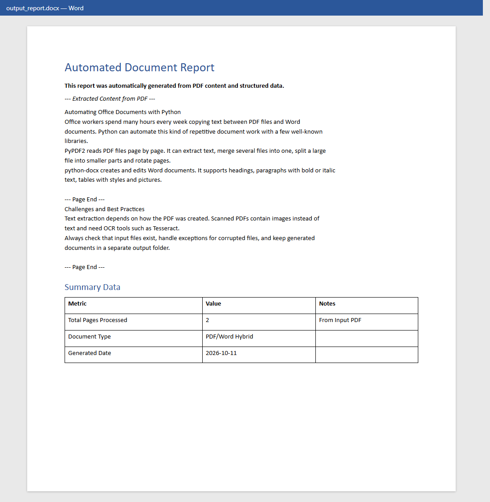
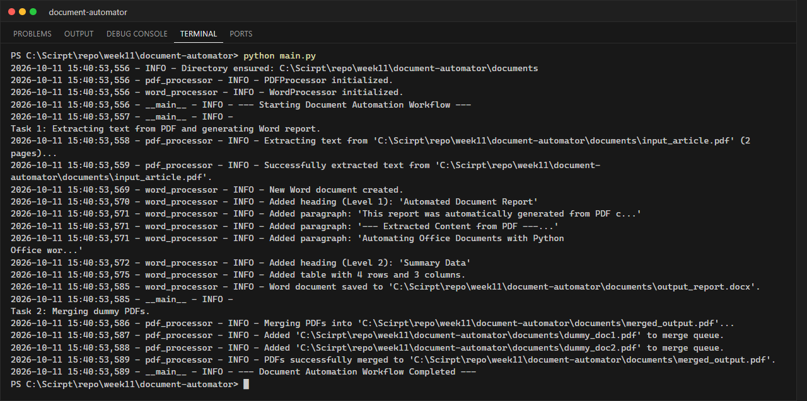

# LabX BASIC Week 11: Automating PDFs & Word Documents

**นักศึกษา:** อัษฎาวุธ เรือนแก้ว (663380303-5) · Section 2

โปรแกรมจัดการเอกสารอัตโนมัติด้วย **PyPDF2** (PDF) และ **python-docx** (Word)

## สิ่งที่โปรแกรมทำ

**Task 1 — PDF → Word report**
1. ดึงข้อความทุกหน้าจาก `documents/input_article.pdf` (`PdfReader` + `page.extract_text()`)
2. สร้างเอกสาร Word ใหม่: Heading, ย่อหน้าตัวหนา/ตัวเอียง/จัดกึ่งกลาง, ข้อความที่ดึงมา
3. เพิ่มหัวข้อ "Summary Data" และตารางสไตล์ `Table Grid` (จำนวนหน้าที่ประมวลผล, ชนิดเอกสาร, วันที่สร้าง)
4. บันทึกเป็น `documents/output_report.docx`

**Task 2 — Merge PDFs**
รวม `dummy_doc1.pdf` (1 หน้า) + `dummy_doc2.pdf` (2 หน้า) ด้วย `PdfWriter` → `documents/merged_output.pdf` (3 หน้า)

นอกจากนี้ `PDFProcessor` ยังมีเมธอด `split_pdf()` สำหรับแยก PDF และ `WordProcessor` มี `add_picture()` สำหรับแทรกรูป

## โครงสร้างโปรเจกต์

```text
document-automator/
├── documents/
│   ├── input_article.pdf     # input (สร้างด้วย create_sample_pdfs.py)
│   ├── dummy_doc1.pdf        # input สำหรับ merge
│   ├── dummy_doc2.pdf        # input สำหรับ merge
│   ├── output_report.docx    # ผลลัพธ์ Task 1
│   └── merged_output.pdf     # ผลลัพธ์ Task 2
├── screenshots/
├── src/
│   ├── __init__.py
│   ├── pdf_processor.py      # extract_text_from_pdf, merge_pdfs, split_pdf
│   ├── word_processor.py     # create_document, add_heading, add_paragraph, add_table, add_picture, save_document
│   └── utils.py
├── create_sample_pdfs.py     # สร้าง PDF ตัวอย่างด้วย reportlab
├── main.py
└── requirements.txt
```

## วิธีรัน

```powershell
pip install -r requirements.txt
python create_sample_pdfs.py   # (ครั้งแรก) สร้างไฟล์ PDF input
python main.py
```

## ผลลัพธ์

### merged_output.pdf


### output_report.docx


### Terminal


## ข้อควรระวัง
- PDF ที่เป็นภาพสแกนจะดึงข้อความไม่ได้ ต้องใช้ OCR (เช่น Tesseract)
- ข้อความที่ดึงจาก PDF อาจขึ้นบรรทัดใหม่ไม่ตรงกับต้นฉบับ เพราะ PDF เก็บตำแหน่งตัวอักษร ไม่ได้เก็บย่อหน้า
