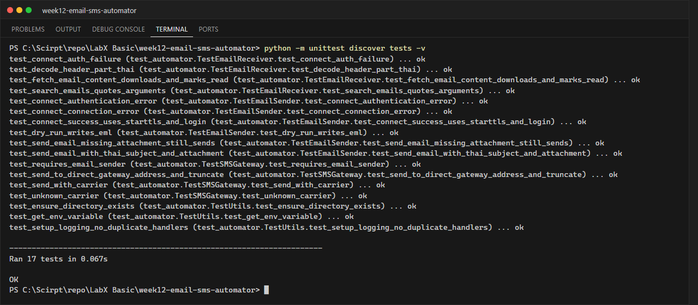
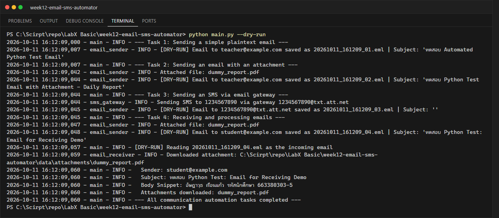

# LabX BASIC Week 12: Automating Communications (Email & SMS)

**นักศึกษา:** อัษฎาวุธ เรือนแก้ว (663380303-5) · Section 2

โปรแกรมสื่อสารอัตโนมัติ: ส่งอีเมลผ่าน **SMTP (STARTTLS)**, ส่ง SMS ผ่าน **Email-to-SMS gateway**
และรับ/ค้นหา/อ่านอีเมลผ่าน **IMAP (SSL)** พร้อมดาวน์โหลดไฟล์แนบ โดยเก็บรหัสผ่านใน `.env`

## Workflow (main.py)

| Task | รายละเอียด |
|---|---|
| 1 | ส่งอีเมลข้อความธรรมดา (ชื่อ-นามสกุล และรหัสนักศึกษา) ไปที่ `TEST_RECIPIENT_EMAIL` |
| 2 | ส่งอีเมลพร้อมไฟล์แนบ `data/dummy_report.pdf` |
| 3 | ส่ง SMS ไปที่ `TEST_SMS_PHONE_NUMBER@<gateway ของ TEST_SMS_CARRIER>` (ตัดเหลือ 160 ตัวอักษร) |
| 4 | ส่งอีเมลหาตัวเองพร้อมไฟล์แนบ → รอ 10 วินาที → ค้นหา `UNSEEN` ตามหัวข้อ → แสดงผู้ส่ง หัวข้อ เนื้อหา 200 ตัวอักษรแรก → ดาวน์โหลดไฟล์แนบลง `data/attachments/` → mark เป็นอ่านแล้ว |

## โครงสร้าง

```text
week12-email-sms-automator/
├── src/
│   ├── email_sender.py    # EmailSender: SMTP + STARTTLS, ไฟล์แนบ, ภาษาไทย (UTF-8)
│   ├── email_receiver.py  # EmailReceiver: IMAP search/fetch, ถอดรหัส header, ดาวน์โหลดไฟล์แนบ
│   ├── sms_gateway.py     # SMSGateway: เบอร์โทร + carrier -> ที่อยู่ gateway
│   └── utils.py           # logging, อ่าน .env
├── tests/test_automator.py  # 17 tests จำลอง SMTP/IMAP ด้วย unittest.mock
├── data/dummy_report.pdf
├── .env.example
└── main.py
```

## วิธีรัน

```powershell
pip install -r requirements.txt
python -m unittest discover tests -v      # ไม่ต้องใช้อินเทอร์เน็ต/รหัสผ่าน
python main.py --dry-run                  # ทดสอบ workflow โดยบันทึกอีเมลเป็นไฟล์ .eml ใน outbox/

copy .env.example .env                    # ใส่ SENDER_EMAIL, SENDER_APP_PASSWORD (Gmail App Password 16 หลัก),
python main.py                            # TEST_RECIPIENT_EMAIL แล้วรันเพื่อส่งจริง
```

Gmail: เปิด 2-Step Verification → สร้าง App password และเปิด IMAP ใน Gmail Settings → Forwarding and POP/IMAP

> SMS gateway รองรับเฉพาะผู้ให้บริการในสหรัฐฯ (att, verizon, tmobile, sprint, boost, cricket, us_cellular)
> เครือข่ายในไทยไม่รองรับ งานจริงควรใช้ API เช่น Twilio

## ผลลัพธ์

### Unit tests


### Terminal (dry-run)


### ภาพหน้าจออีเมลจริง
หลังตั้งค่า `.env` และรัน `python main.py` ให้แคปหน้าจอ Gmail ที่ได้รับอีเมลจาก Task 1, 2 และ 4
แล้วบันทึกเป็น `screenshots/gmail_inbox.png`
