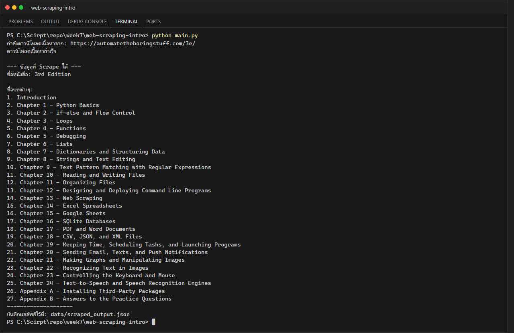

# LabX BASIC Week 7: Introduction to Web Scraping

**นักศึกษา:** อัษฎาวุธ เรือนแก้ว (663380303-5) · Section 2

โปรแกรม Web Scraper อย่างง่ายด้วย `requests` + `BeautifulSoup4` สำหรับดึง **ชื่อหนังสือ** และ **รายชื่อบททั้งหมด**
จากหน้าแรกของเว็บไซต์ [Automate the Boring Stuff with Python (3rd Edition)](https://automatetheboringstuff.com/3e/)

## โครงสร้างโปรเจกต์

```text
web-scraping-intro/
├── src/
│   ├── __init__.py
│   └── scraper.py          # คลาส SimpleWebScraper (_get_html_content, scrape_main_titles)
├── data/
│   └── scraped_output.json # ผลลัพธ์ที่บันทึกจากการรัน (สร้างอัตโนมัติ)
├── screenshots/
│   └── terminal_output.png
├── main.py                 # จุดเริ่มต้นโปรแกรม
├── requirements.txt
├── .gitignore
└── README.md
```

## วิธีติดตั้งและรัน

```powershell
python -m venv venv
venv\Scripts\Activate.ps1
pip install -r requirements.txt
python main.py
```

## การทำงาน

1. `_get_html_content()` ดาวน์โหลด HTML ด้วย `requests.get()` พร้อม `User-Agent` และ `timeout=30`
   และดักจับ `HTTPError`, `ConnectionError`, `Timeout`, `RequestException`
2. `scrape_main_titles()` แปลง HTML ด้วย `BeautifulSoup` แล้ว
   - ชื่อหนังสือ: `<article>` → `<header>` → `<h1>`
   - ชื่อบท: `<div class="content-body">` → `ul li a`
3. `main.py` แสดงผลในเทอร์มินัลและบันทึกผลเป็น `data/scraped_output.json`

## ผลลัพธ์การรัน



## ข้อพิจารณาด้านจริยธรรมและกฎหมาย

- ตรวจสอบ `robots.txt` และ Terms of Service ของเว็บไซต์ก่อนทำการ scrape เสมอ
- ไม่ส่ง request ถี่เกินไปจนเป็นภาระต่อเซิร์ฟเวอร์ (โปรแกรมนี้ส่งเพียง 1 request ต่อการรัน)
- ข้อมูลที่ scrape อาจมีลิขสิทธิ์ ใช้เพื่อการศึกษาเท่านั้น
- หากเว็บไซต์มี API ให้ใช้ API แทนการ scrape
