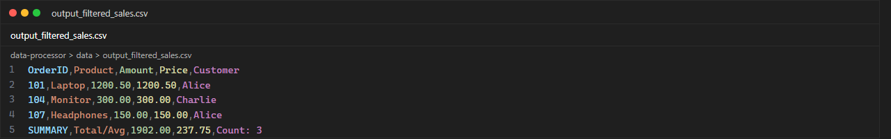
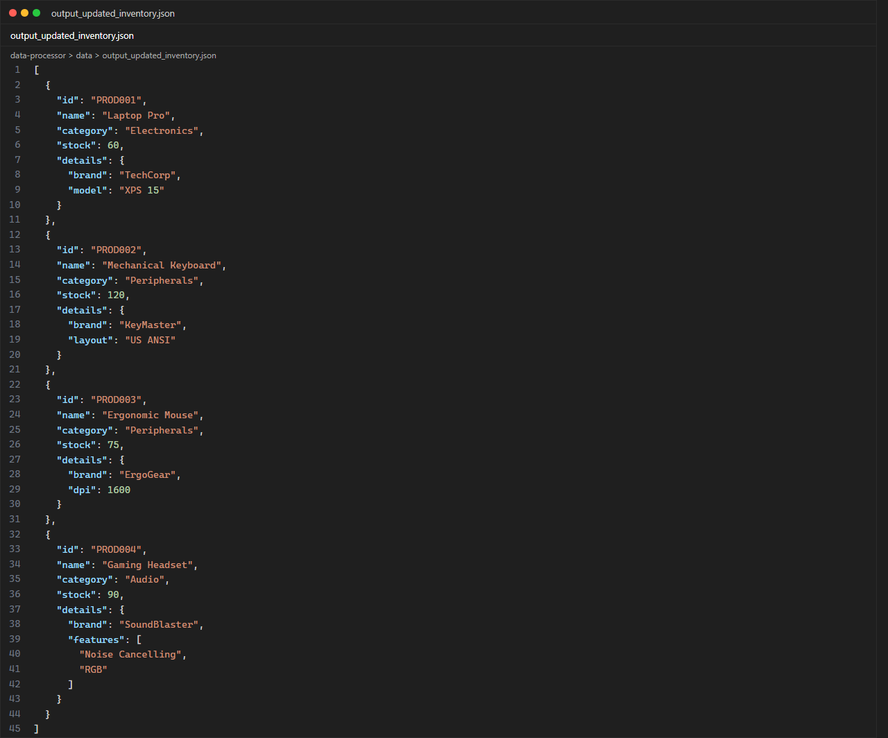
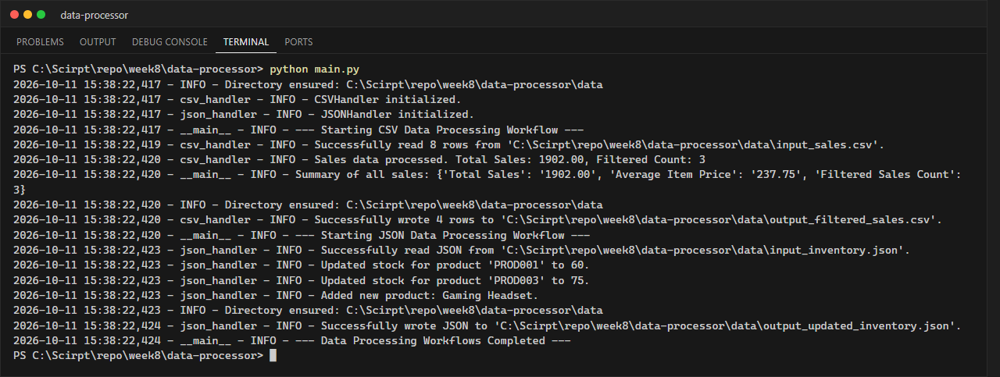

# LabX BASIC Week 8: Automating with CSV and JSON Data

**นักศึกษา:** อัษฎาวุธ เรือนแก้ว (663380303-5) · Section 2

โปรแกรมประมวลผลข้อมูลอัตโนมัติด้วยโมดูลมาตรฐาน `csv` และ `json` ของ Python (ไม่ต้องติดตั้งไลบรารีเพิ่ม)

## สิ่งที่โปรแกรมทำ

**CSV Workflow** (`data/input_sales.csv` → `data/output_filtered_sales.csv`)
1. อ่านไฟล์ CSV เป็น list ของ dictionary ด้วย `csv.DictReader`
2. คำนวณยอดขายรวม (Total Sales) และราคาเฉลี่ยต่อชิ้น (Average Item Price)
3. กรองเฉพาะรายการที่ `Amount >= 100`
4. เขียนผลลัพธ์พร้อมแถวสรุป `SUMMARY` ด้วย `csv.DictWriter`

**JSON Workflow** (`data/input_inventory.json` → `data/output_updated_inventory.json`)
1. อ่านข้อมูลคลังสินค้า (nested JSON) ด้วย `json.load`
2. อัปเดตสต็อก `PROD001` → 60 และ `PROD003` → 75
3. เพิ่มสินค้าใหม่ `PROD004` (Gaming Headset)
4. บันทึกด้วย `json.dump(..., indent=2, ensure_ascii=False)`

## โครงสร้างโปรเจกต์

```text
data-processor/
├── data/
│   ├── input_sales.csv
│   ├── input_inventory.json
│   ├── output_filtered_sales.csv        # ผลลัพธ์
│   └── output_updated_inventory.json    # ผลลัพธ์
├── screenshots/
├── src/
│   ├── __init__.py
│   ├── csv_handler.py    # CSVHandler: read / write / process_sales_data
│   ├── json_handler.py   # JSONHandler: read / write / update_inventory / add_product
│   └── utils.py          # setup_logging, ensure_directory_exists
├── main.py
└── .gitignore
```

## วิธีรัน

```powershell
python main.py
```

## ผลลัพธ์

ตรวจสอบตัวเลข: ยอดขายรวม = 1200.50 + 25 + 75.25 + 300 + 45.75 + 90 + 150 + 15.50 = **1902.00**,
ราคาเฉลี่ย = 1902.00 / 8 = **237.75**, รายการที่ ≥ 100 มี **3** รายการ (Laptop, Monitor, Headphones)

### output_filtered_sales.csv


### output_updated_inventory.json


### Terminal

